# Theme kits: one card, any look

Cards should take a new look without being redrawn for it, and a new card should arrive in every
look without being drawn once per look. This document describes how theming and component
customisation make that work, and how to add a brand-style theme or a new component.

It extends the uber themes in [card-component-system.md §5](card-component-system.md#5-uber-themes)
and keeps every rule there: chrome from the theme, semantic data colours, `HaType`, parts draw no
chrome, and values bound by name ([live-card-updates.md](live-card-updates.md)).

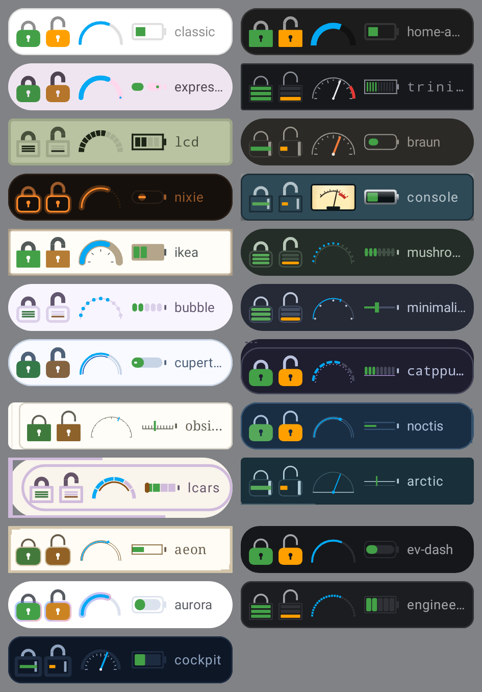

*One lock component, with no code specific to any theme, drawn locked and unlocked under all 23
themes beside a dial and the `Switch` slot. A segment LCD lights bars, Braun and Cockpit slide a bolt,
Nixie glows, and a kit uses its own tokens.*

## The problem: N themes × M components

The bespoke uber themes (Console, LCD, Trinitron, …) draw each visual by hand: every Layer 2 meter
has an exhaustive `when (family)` over 19 families, and some cards branch on a family's identity
(`visualFamily() == HaVisualFamily.Console`). That gave the bespoke themes their character, but it
does not scale:

- a **new theme** (an EV dashboard or an engineered-appliance style) needs a drawing in every
  `when`: about 40 files;
- a **new component** (a car's door lock) needs a drawing for every family: 19 drawings.

## The model: tokens, grammar, slots

A theme is three layers, each a fallback for the one above it:

```
 HaUberTheme
 ├─ tokens      palette (HaTheme) · shape (HaCardShapeStyle) · type (font, tracking, weight)
 │              · motion (RcMotionScheme) · ink                               ── existing
 ├─ grammar     HaComponentGrammar: stroke weight · round/flat caps
 │              · level = Continuous | Segmented(n) | Pointer · ticks · track gap
 │              · stop dot · glow · gradient halo · outline bodies            ── new
 └─ components  HaComponentSlots: the theme's own drawing per slot — visuals
                (ArcMeter, BarMeter, Thermometer, Battery, Lock), controls
                (Switch, Key, DialRing, DialLayout, TransportKey, IconChip),
                surfaces (WearContainer, Charts, TextSurfaces) and Layouts    ── new
```

**Resolution.** A part asks the active theme for its slot's drawing:

1. the theme's own drawing for that slot (`theme.components`), else
2. for a part that predates slots, the bespoke family's own: its hand drawing where it has one
   (the meters in `Meters<Family>.kt`; see [Bespoke families draw only what is
   theirs](#bespoke-families-draw-only-what-is-theirs)), and the switch and key mount from the one
   family table in
   [`HaControls.kt`](../../rc-components/src/commonMain/kotlin/ee/schimke/ha/rc/components/HaControls.kt)
   (`familySwitch`, `familyKey`), else
3. the shared drawing, which reads only the theme's grammar and tokens: `GrammarMeters.kt` for
   visuals, `TokenSwitch` and `GrammarKey` for controls.

A slot takes one kind of renderer: a canvas drawing for a visual (`HaVisualRenderer`), a
composable control for the switch (`HaSwitchRenderer`, handed live knob and colour progress, the
accents, and the caller's click), and a modifier for a key's mount (`HaKeyRenderer`, applied
inside the caller's target so the action, accessible name and touch area stay with the card).
`HaComponentSlots` rejects a renderer of the wrong kind.

Every bespoke family has a grammar derived from it (`HaComponentGrammar.forFamily`): LCD and
Trinitron are segmented, Braun and Console use a pointer, Expressive is bold with a gap and stop
dot, Nixie glows. So a component with only a grammar drawing still looks native in a bespoke
theme. The lock above is that case: it has no LCD drawing, yet under LCD it is an LCD lock.

**Two kinds of theme.**

| | Bespoke theme | Theme kit |
|---|---|---|
| What it is | its own `HaVisualFamily`, drawn by hand | tokens + grammar over a bespoke theme it `extends` |
| Older visuals | the family's `Meters<Family>.kt` where it has a drawing, else the grammar | `HaComponentSlots.Grammar` (all slots drawn from the grammar) |
| New components | grammar drawing, from its derived grammar | grammar drawing, from its own grammar |
| Controls, Wear container, charts, text surfaces | the family's own, from the family tables | drawn from its grammar, or a family's it borrows |
| Layouts (tile, media panel, readings, notes, …) | the family's row in `familyLayouts` | inherited from the base it extends, unless it sets its own |
| Cost to add | a family, about 40 files | one `HaUberTheme(...)` value |

### Bespoke families draw only what is theirs

A bespoke family keeps a hand drawing only where it says something the grammar cannot. Everything
else is the grammar's drawing in the family's own tokens (`HaComponentGrammar.forFamily`), through
the same family tables (`FamilyVisuals`, `FamilyCharts`):

| Family | From the grammar | Its own (the novel bits) |
|---|---|---|
| Classic (the cards' own) | arc, bar, thermometer, battery, dial ring, history line, statistics bars | — |
| Home Assistant | bar, thermometer, battery, history line, statistics bars | the chunky half gauge, the thermostat ring with its white handle |
| Material 3 Expressive | arc, bar, thermometer, battery, dial ring, statistics bars | the filled history trace; its switch, icon-chip morph, split slider and wavy progress |

The grammar learned the one rule that made this possible: a **gapped** grammar (`trackGap`, the
grammar of M3 Expressive's progress indicators) draws a bare capsule thermometer with no bulb and a
pill battery with no body outline.

The other bespoke families (Trinitron, LCD, Braun, Nixie, Console, IKEA and the community styles)
keep their meters: each is a design of its own, and in the community styles all of them come from
just two short per-family grammars (`communityRing`, `communityBar` in `MetersCommunity.kt`).

To move another family×part onto the grammar, render the family beside
`theme.copy(components = HaComponentSlots.Grammar)`. Where the two read the same, point its row in
the family table at the grammar and delete the drawing. Where they differ, decide whether the
difference is the style or a missing grammar rule.

## Adding a component (the car door lock)

[`RemoteHaLock.kt`](../../rc-components/src/commonMain/kotlin/ee/schimke/ha/rc/components/RemoteHaLock.kt)
is the reference:

1. Add a `HaComponentSlot` entry.
2. Write **one** grammar drawing in `GrammarMeters.kt`, and register it in
   `HaComponentSlots.Grammar`. Use the grammar's terms rather than a family's: what a
   `Segmented` lock shows (lit bars), what a `Pointer` lock shows (a sliding bolt), and what
   `outline`, `roundCaps`, `glow` and `stroke` do to it. Follow the meter rules: fit the canvas at
   your own aspect, size everything from the canvas at playback, put the track in `divider`, the
   value in the caller's live colour, and move moving parts by the live fraction.
3. Add the composable: resolve with `themedRenderer(slot) ?: GrammarRenderers.X` and draw with
   `render(...)`. Never branch on `visualFamily()`.
4. Bind live data by name. `RemoteHaLiveLockGlyph` reads `<entityId>.is_on`, which hosts push as
   `true` while a lock is `locked`, and animates the change with `haMotion().spatial`, so the
   first frame shows the seeded value.
5. Make it semantic. The body is `HaStatusColors.Normal` when locked and `Warning` when unlocked,
   made legible with `haLegible`. A theme with an ink prints both in its ink and carries the state
   in the shackle and bars.

`RemoteHaLockRow` (glyph, name, live state) is then a card part: a car's doors, boot and charge
port are a column of these, and a front door is one. A theme that wants a bespoke lock (Console's
brass padlock, say) overrides `HaComponentSlot.Lock` and nothing else changes.

## Controls: the switch and the key mount

Cards ask for controls by role. `RemoteHaToggleSwitch` (an entities row, a tile) and
`haKeyChrome(accent, selected)` (about twenty key, chip and button sites across the cards) used to
branch on Console, IKEA, Expressive and the community families. They now resolve through the
`Switch` and `Key` slots, and no card names a family for them. `HaControlSlotsTest` checks that.

- **Bespoke themes are unchanged.** The family table hands Expressive its M3 switch, IKEA its
  paddle and moulded keys, Console its rocker and machined keys, and the community families their
  thumbs. Classic, Home Assistant, Trinitron, LCD, Braun and Nixie keep the token switch and keys
  with no mount. All 39 `Uber*` previews render byte-identical before and after the move.
- **Kits draw the shared controls.** `TokenSwitch` takes its look from the shape tokens (track
  corner, square or round knob), the material (a machined cap on painted metal) and the ink.
  `GrammarKey` draws nothing on a filled grammar, an outlined rim in the live accent on an outline
  grammar (Engineered), and a selected mode key's dot, with a halo on a glowing grammar.
- **A kit can borrow a family's control.** Aurora keeps Material 3 Expressive's switch with
  `HaComponentSlots.Grammar.with(HaComponentSlot.Switch, FamilyControls.ExpressiveSwitch)`.
- **One filament stays a token.** A painted-metal switch's lamp warms on the fast effect and
  cools on the slow one. That is now keyed on `HaSurfaceMaterial.PaintedMetal`, not on Console.

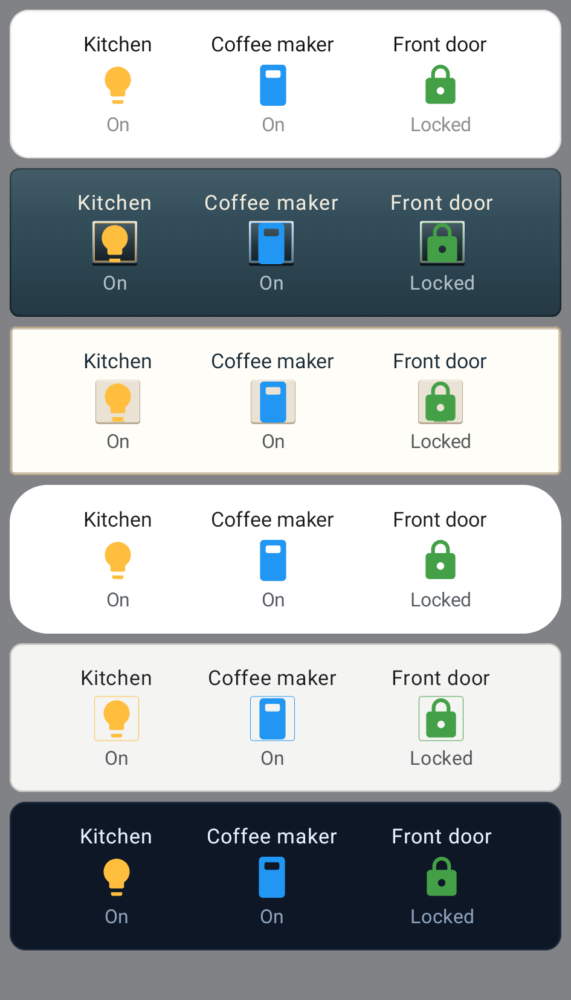

### The control dial, transport keys and icon chip

Three more controls resolve the same way. Each family's own moved unchanged into the one table in
`HaControls.kt` (`familyDialLayout`, `familyTransportKey`, `familyIconChip`), and the cards ask by
role.

- **Control dial: two slots.** `DialRing` draws the 270° ring of a thermostat, humidifier or
  light. Kits get `GrammarRenderers.Dial`, built from their grammar:
  - Engineered: a ring of cells, lit as layers so a widget can play them.
  - Cockpit: ticks with a pointer on the ring. A needle from the centre would cross the readout.
  - Aurora: a gradient halo under the arc.
  - EV Dash: a thin arc.

  The target marker hides by size, not by colour. `DialLayout` is data rather than a drawing: which
  body a card shows (the ring, Console's thermostat with a separate set-point knob, Cupertino's bar,
  IKEA's light remote) and whether the steppers sit beside it (Bubble, Cupertino, LCARS, Aeon).
  Bespoke rings keep their fallback table: Classic's arc, Console's knob, the rest in `Dials.kt`.
- **Transport keys.** `TransportKey` draws the media card's previous, play/pause and next keys, and
  the compact play glyph. Console keeps its key faces with pilot lamps. Everything else is
  `TokenTransportKey`: the icon in the marking colour, mounted on the theme's `Key` slot when it
  has one. That gives IKEA its moulded key and Engineered an outlined rim.
- **Icon chip.** `IconChip` draws the button card's chip:
  - Expressive: the shape morph. It is `pressable`, so the card tracks a press only for chips that
    react to one.
  - Console: its key face.
  - IKEA: its moulded key.
  - Everyone else: `TokenIconChip`, a tinted round face with the theme's key mount when it has one.

  Aurora borrows Expressive's chip, as it borrows its switch.
- **Unchanged.** 187 previews (all `Uber*` showcases plus media, button, thermostat, dial, light
  and humidifier) render byte-identical before and after the move.

| Dials | Soft dials | Media keys | Button chips |
|---|---|---|---|
| 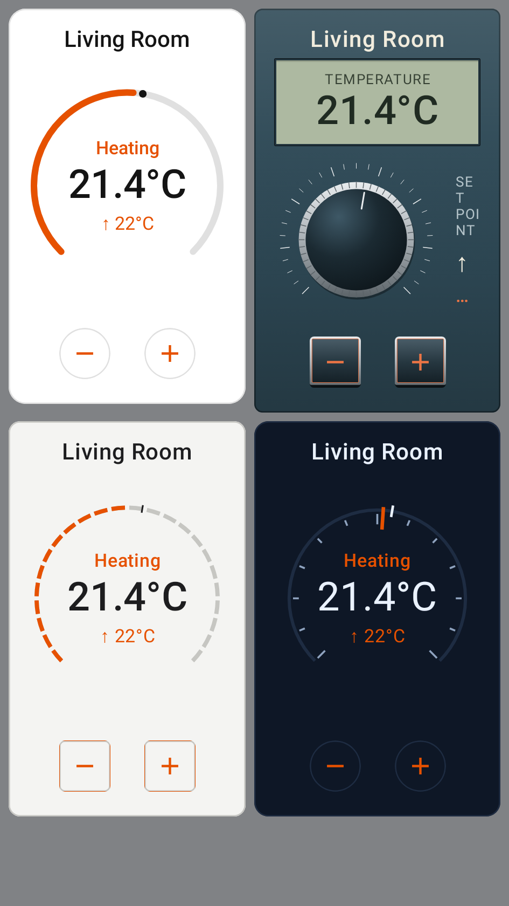 | 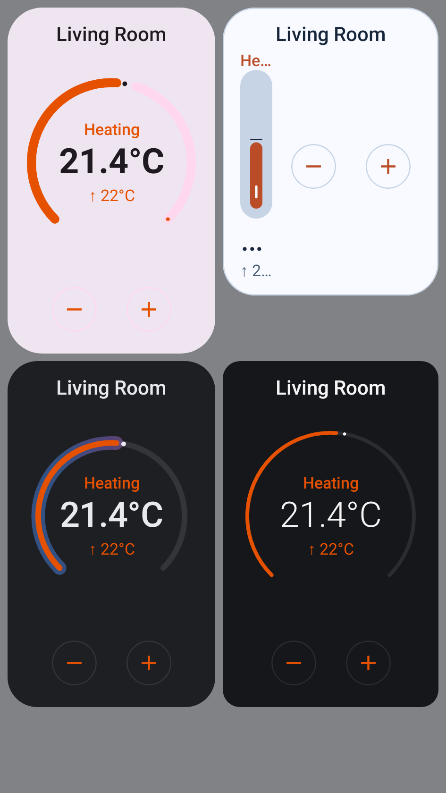 | 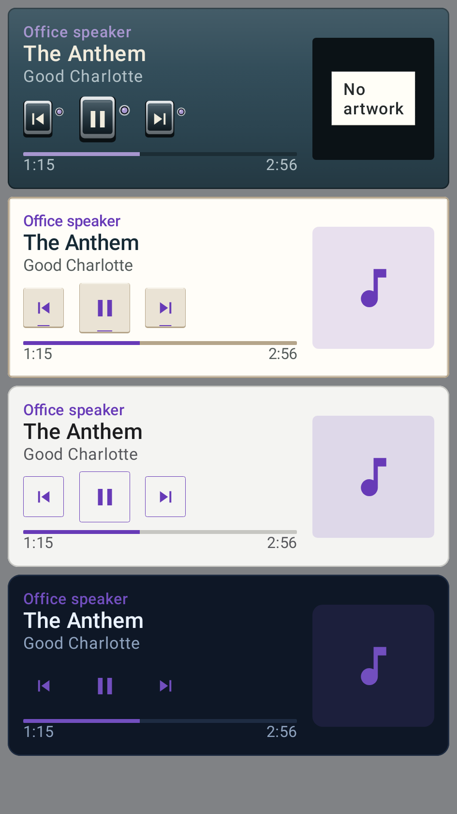 | 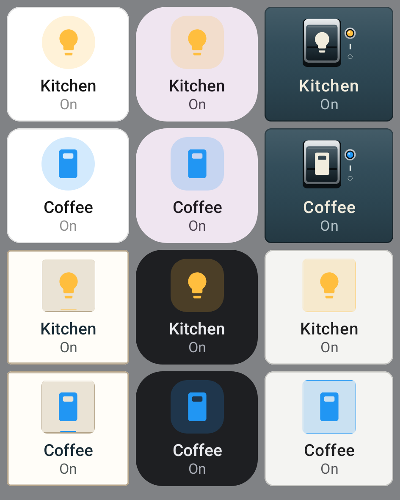 |

## Adding a brand-style theme

[`ThemeKits.kt`](../../rc-components/src/commonMain/kotlin/ee/schimke/ha/rc/components/ThemeKits.kt)
has four kits:

| Kit | Genre | Extends | Grammar |
|---|---|---|---|
| `ev-dash` | an electric car's centre screen | classic | light strokes, round caps, smooth fill; light numerals |
| `aurora` | an assistant's gradients | expressive | regular, round, a glowing **gradient halo** under each value |
| `engineered` | an engineered appliance's display | braun | light, flat, **24 fine segments**, outlined bodies; fuchsia accent |
| `cockpit` | a car's digital cluster at night (dark only) | trinitron | flat, **pointer needles** over 12 ticks |

|  |  |  |
|---|---|---|
| 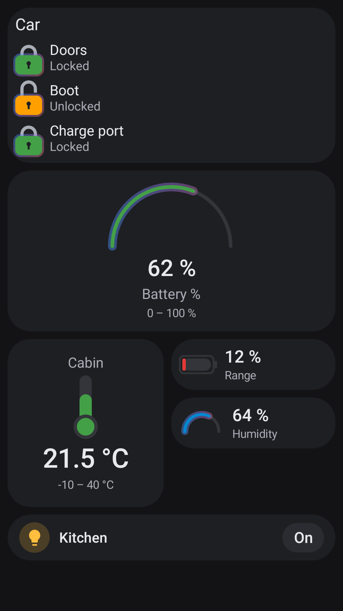 | 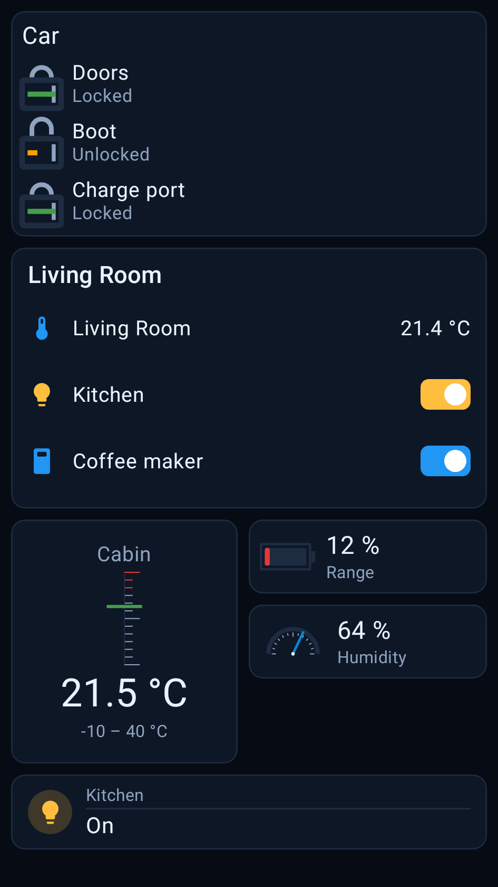 | 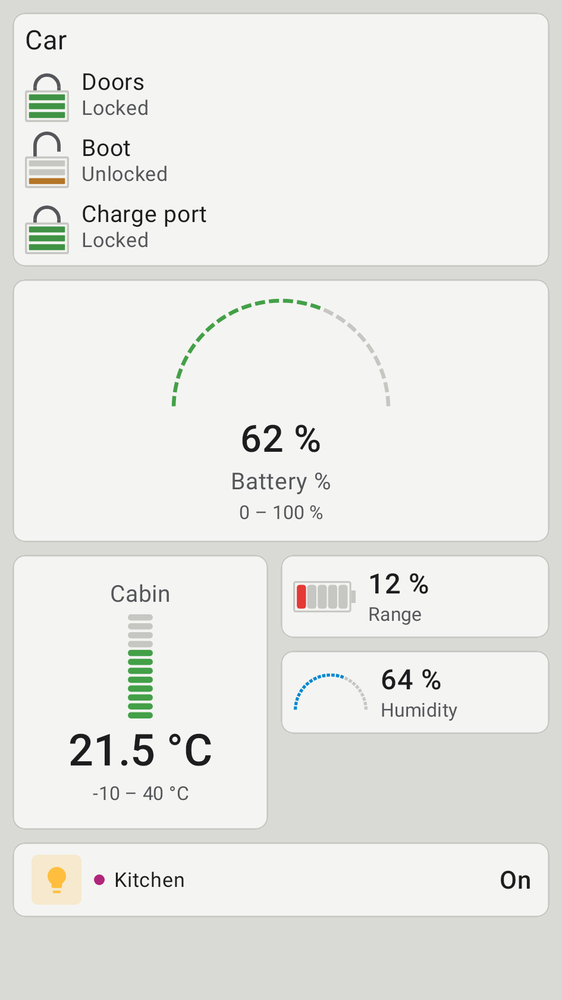 |

To add one:

1. Choose the bespoke theme it `extends`. That is what its card layouts and controls inherit until
   they move into slots.
2. Write the tokens: a light and/or dark `HaTheme` (primary and secondary text at 4.5:1 or more on
   the card, accent at 3:1 or more; `kitPalettesAreLegible` checks this), the shape, the font
   family, weight and tracking, and a motion scheme.
3. Write the grammar. Most of a look is here: how heavy, round or flat, and whether a level is
   smooth, segmented or a pointer.
4. Set `components = HaComponentSlots.Grammar`, plus any overrides that make it itself (for
   example `HaComponentSlots.Grammar.with(HaComponentSlot.ArcMeter, mySweep)`).
5. Register the id. Until the lists below read `HaUberTheme.all`, that means `HaUberTheme.all`,
   `CardStylePref`, the Settings tagline `when`, the design server's style picker
   (`dashboard/index.html`), the `ha-cards/uber-theme` policy's `allowedValues`, and the demo's
   style list. The design server's request check already reads `HaUberTheme.all`.
6. Add a `Kit_*` preview in `ThemeKitPreviews.kt`. Kits use the default launcher icon until one
   is drawn for them.

### Brands

A kit evokes a **genre**, not a company. Ids, display names, palettes and drawings are original,
and the code ships no brand name, logo, proprietary typeface or traced artwork. This is the same
rule the IKEA-inspired showroom and the Sony-inspired Trinitron follow. "Tesla style" becomes an
EV centre-screen kit, "Gemini style" an assistant-gradient kit, "Dyson style" an engineered
appliance kit, and "VW style" a cockpit kit. A licensed partner theme with real marks and fonts
would be the same kit with licensed assets, behind whatever agreement allows it; it would need no
code change.

## Rules that do not bend

- **Semantic colours win over brand colours.** A grammar `gradient` is a halo **under** the value.
  The value keeps its own colour, so a locked lock stays green and a severity band stays red. The
  first Aurora render broke this, painting locked and unlocked locks the same gradient, which is
  why the rule exists.
- **No family checks in new code.** A new part never calls `visualFamily()`. If a theme needs to
  differ, that difference is a grammar token (if many themes would use it) or a slot override (if
  one theme would).
- **Live, then styled.** A slot drawing is handed the live fraction and live colour. It cannot
  read entity state itself, so a theme can't break the binding contract.

## The Wear container, charts, text surfaces and layouts

The last family branches in card code moved the same way.

- **`WearContainer`** is data: the watch container's fill, its layers (glows, gradients, bands)
  and edge, and how a level reading shows in it (`HaWearBackground`, `HaWearLevelLook`). The watch
  host draws it at its own shape. Bespoke styles keep their containers, moved unchanged into
  `FamilyWearContainer`. Kits get `GrammarWearContainer`, so they show on the watch as themselves:
  - Aurora: a gradient edge and diagonal sweep.
  - Engineered: an outline with a hairline top and a segmented fill.
  - Cockpit: an accent index band, a glow from the foot and a pointer ring.
  - EV Dash: a faint top light and a thin ring.

  Before, a kit wore its base style's container in its own colours.
- **`Charts`** draws a history sparkline and a statistics bar row. Bespoke styles keep their
  traces (`HistoryTraces.kt`) and bars (`Charts.kt`) through `FamilyCharts`. Kits get
  `GrammarCharts`:
  - Engineered: ghosted cells lit as layers.
  - Cockpit: a hairline over ticks with the newest sample dotted.
  - Aurora: a line with a gradient halo.

  The app's secondary screens follow the same grammar for kits (`chartStyleFor(grammar)` in
  `ScreenSkin`).
- **`TextSurfaces`** covers the heading card, a markdown note's material and its title. Kits get
  them from the grammar:
  - Engineered: a heading ruled to the edge and a leading bar on the note.
  - Cockpit: an index dot.
  - Aurora: a tonal capsule.
  - EV Dash: a plain line.
- **`Layouts`** is data, named by layout rather than family. It covers:
  - tile composition and chip;
  - the service-tile key;
  - the card frame;
  - the media panel and empty artwork;
  - gauge and expanded-reading layouts;
  - the unavailable label and short notes ("No entities", taped on Console);
  - solid key faces, the clock face, the two-up entities grid;
  - the slider and the progress ring.

  `familyLayouts` is the one table where a family names them. Kits inherit the layouts of the style
  they extend, since layouts are composition rather than drawing. A kit can set its own, for
  example `HaComponentSlots.Grammar.with(HaComponentSlot.Layouts, HaLayouts(media =
  HaMediaLayout.Cinema))`.

| Wear | Text surfaces | History | Statistics |
|---|---|---|---|
| 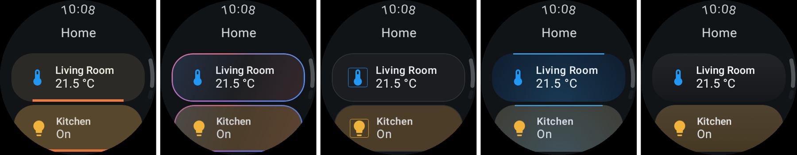 | 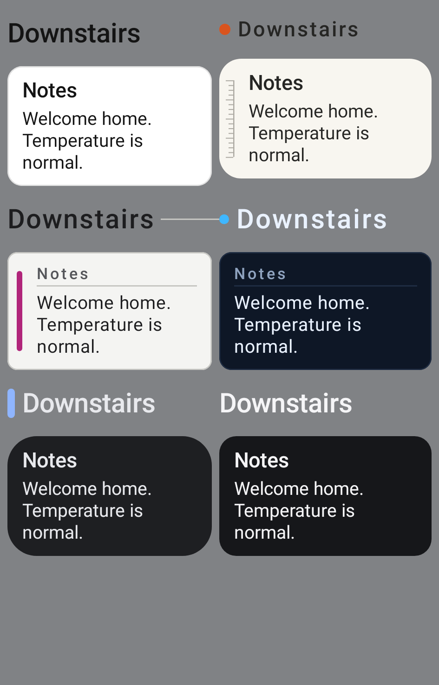 | 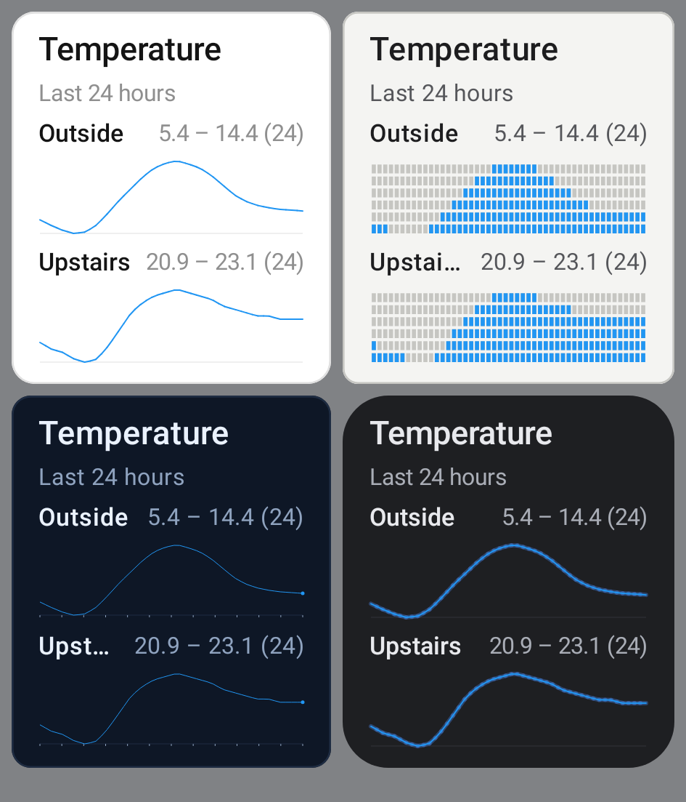 | 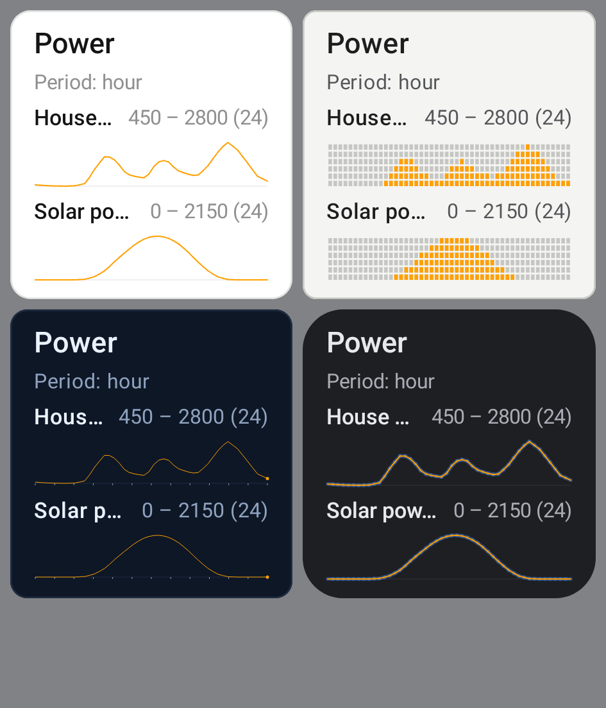 |

## Where families are still named

No card names a style family. `HaControlSlotsTest.cardsAskByRoleNotFamily` checks every
`RemoteHa*` card file and the card chrome. Families are named only in the registries:
- the theme definitions (`HaUberTheme`, `CommunityThemes`);
- the grammar each family implies (`HaComponentGrammar.forFamily`) and its motion
  (`HaMotion.forFamily`);
- the family tables (`HaControls`, `HaLayouts`, `FamilyVisuals`, `FamilyWearContainer`,
  `FamilyCharts`, `FamilyTextSurfaces`);
- each family's own drawings: `Meters<Family>.kt`, `Dials.kt`, `HistoryTraces.kt`, `Charts.kt`,
  `TileFamilies.kt`, `CommunityLayouts.kt`, `CommunityControls.kt` and `EverydaySurfaces.kt`;
- the app's own skin table for its secondary screens (`ScreenSkin`).

A new bespoke family is added to those tables. A new kit or component touches none of them.

The theme id lists outside the catalogue are held to it by tests:
- `CardStylePref` in the app (`CardStyleListsTest`);
- the design-server studio's picker (`StudioStyleListTest`);
- the `ha-cards/uber-theme` policy (`HaCardMeasurementsTest`).

The web demo's style list is a curated subset.

Renderer types (`HaVisualRenderer`, `HaVisualSpec`) are `internal` to `rc-components` for now.
Making them public is the step that lets a theme come from outside the module, for example from
the design server.
