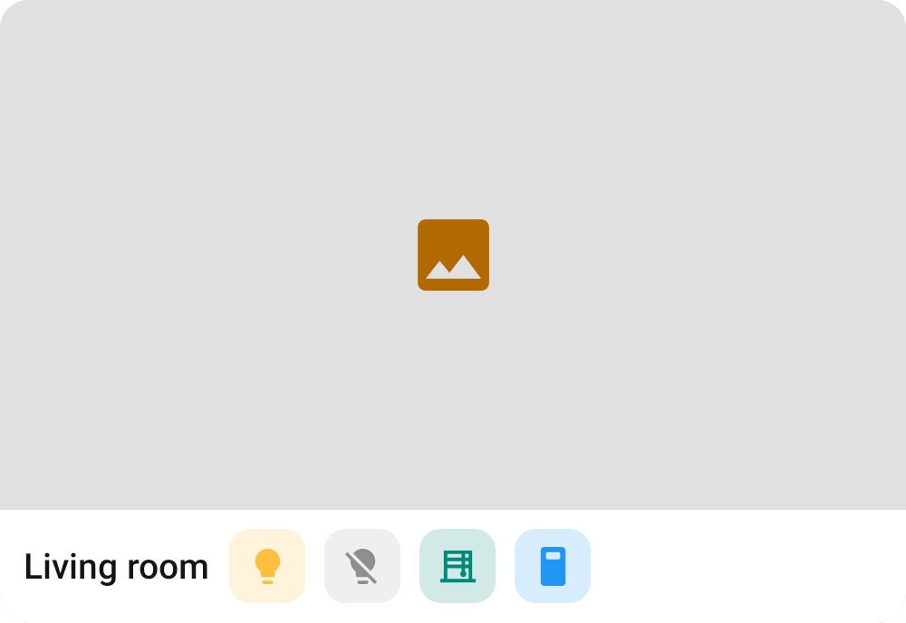
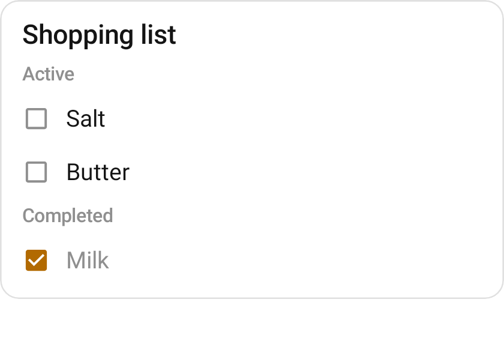
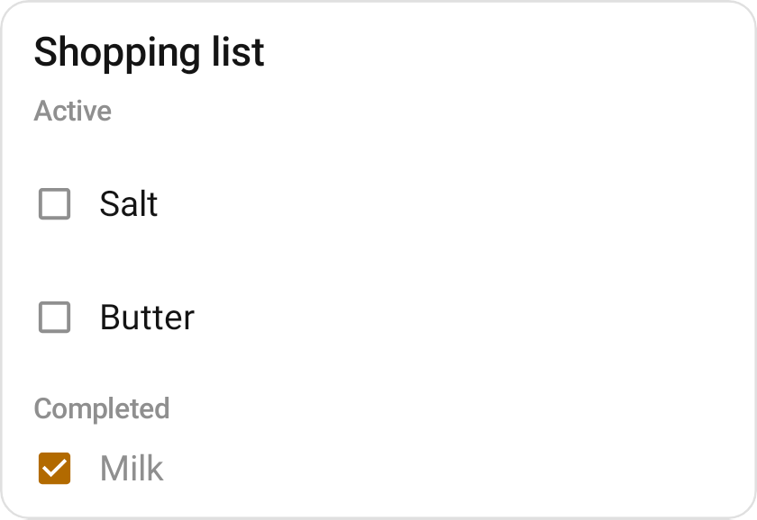
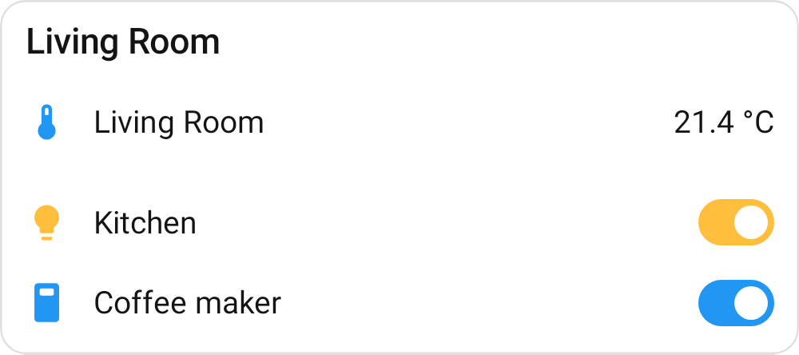
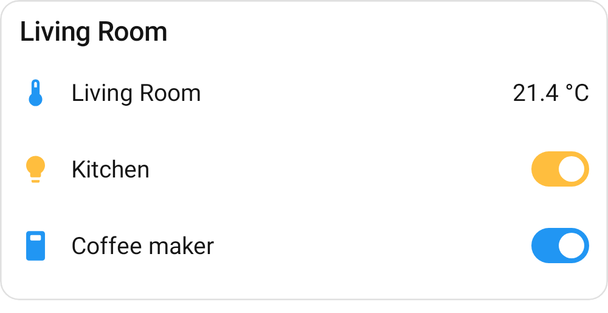
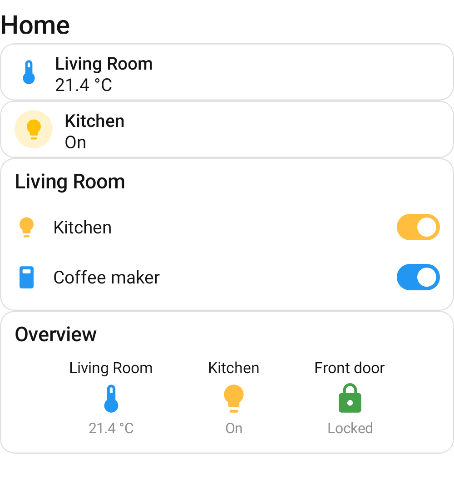
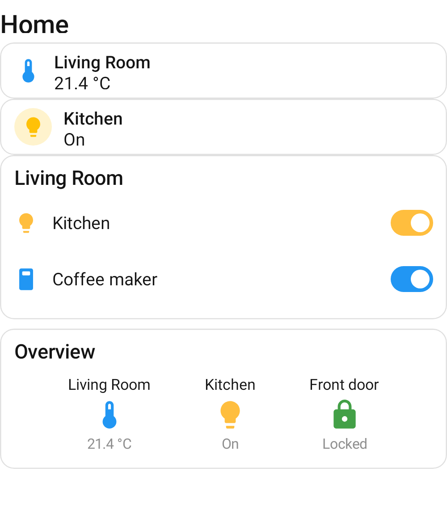

# Card touch targets

The accessibility report on #881 flagged touch targets under 48dp in these previews. Renders are the
`previews` module at `widthDp = 381`, before (main, 2eb8cf01) and after this change, light theme.

| Card | Before | After | What changed |
| --- | --- | --- | --- |
| Media control |  |  | Transport buttons are 48dp targets around the same 32/40dp buttons; the row pulls in by the difference, so they draw in place (the row is 2dp taller). Labelled Previous / Play or Pause / Next. |
| Picture glance |  |  | Entity cells are 48dp targets around the same 32dp cell, filling the strip's vertical inset; same positions. The cells draw as the circles their shape asks for (`clickable` ahead of `clip` had made them rounded squares). |
| To-do list |  |  | Item rows are 48dp tall (HA's list row height), up from ~26dp: the one visible layout change. |
| Entities |  |  | The row is the tap target; its switch no longer takes a separate 36 × 22dp tap for the same action. The preview canvas grows to the card's natural height (it was clipping the last row). |
| Dashboard |  |  | The entities slot grows to the card's natural 148dp (it was squeezing the rows to 42dp). |

RemoteCompose clamps a child to its parent, so a tap area cannot spill past a control's layout
bounds; `RemoteHaTouchTarget` makes the control's box the 48dp target and draws the control at its
own size inside it, and callers pull surrounding spacing in to keep the drawn positions.

`CardTouchTargetTest` plays each card and asserts every tappable node is at least 48dp each way; it
fails on main with media 32/40/32dp, picture glance 32 × 32dp, to-do rows 353 × 18dp and entities
switches 36 × 22dp.
