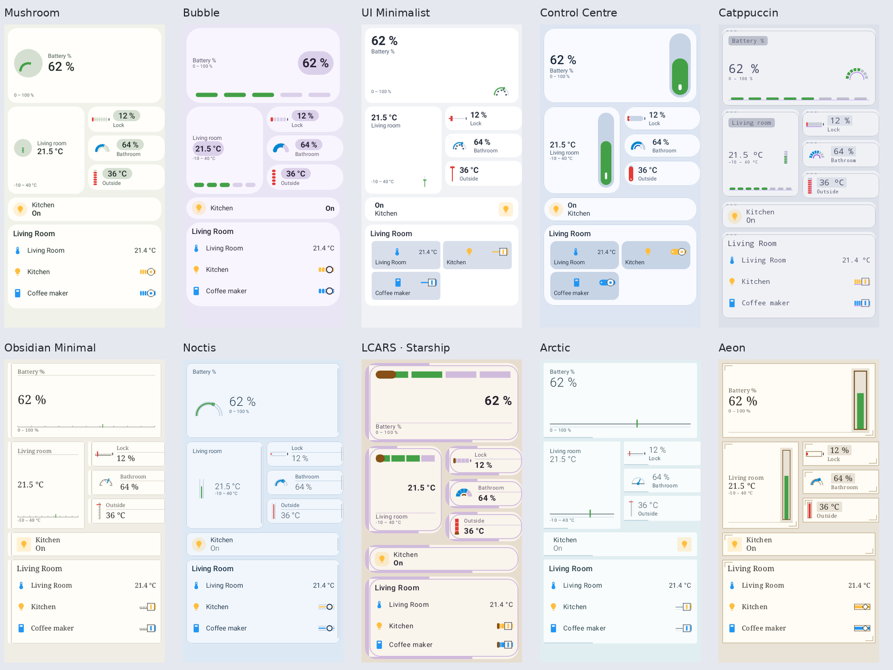
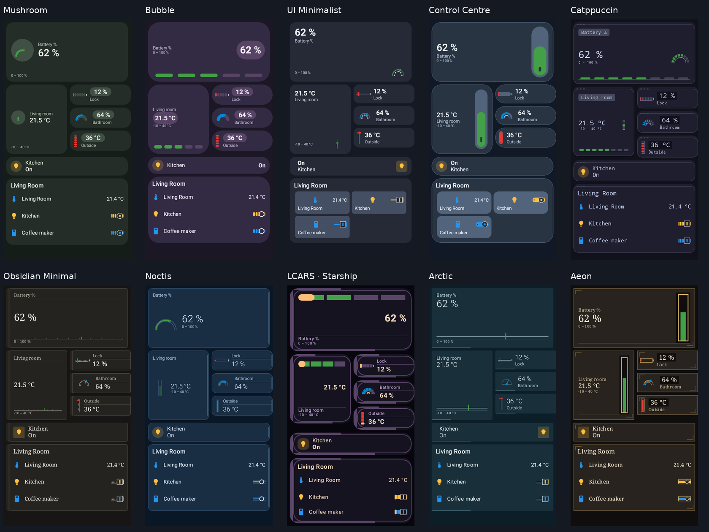
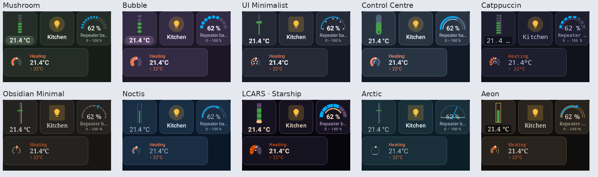

# Community family rendering evidence

Source/design rationale, card coverage, live contracts and platform boundaries:
[community-families.md](../../community-families.md).

The two contact sheets compare the same realistic cards in all ten families,
with one sheet per mode. Individual `*-light.png` / `*-dark.png` preserve detail.
`*-dials.png` covers thermostat and humidifier; `*-light-control.png` covers light
controls; `*-cards.png` covers history and statistics; `*-media-alarm.png` covers
media and alarm; `*-compact.png` covers three 96×96dp
widget cells and a 240×80dp thermostat. All images are at most 1800px per dimension.

`classic-before.png` and `console-before.png` are the existing published baseline,
from output commit `cfa0d9df1a7bf68ada8e71ef565a82e755798977` (render history source
`9d4b78c8`). They show the pre-existing designs for context, rather than a "before"
version of the ten new styles, which did not exist.

Reproduction:

```sh
./gradlew :card-designs:testDebugUnitTest --tests '*CommunityFamilyEvidenceTest' \
  -PcardDesignsOut=/tmp/community-designs
PYTHONPATH=<Pillow installation> python3 scripts/community-contact-sheet.py \
  /tmp/community-designs/community-renders docs/design/evidence/community-families
./gradlew :rc-components:testDebugUnitTest :ha-cards-catalog:testDebugUnitTest
./gradlew :rc-converter:testDebugUnitTest --tests '*CommunityFamilyLiveRenderTest'
```

The 70 authored previews use mdpi device specs and pages of at most 680dp in height.
The bounded native test uses explicit mdpi dimensions; the published catalog still
uses the normal PNG plus `.rc` sidecar workflow for each single-document page.
Compact pages host independent widget documents and intentionally offer no sidecar.
Longer controls/content are split
across pages, so even a host using the default 2.625 density stays below 1800px.

The standard CLI attempt was stopped: CLI 2.68.4 / plugin 2.68.2 included unrelated
previews despite its filter and ignored the explicit device dpi. Its first dial
image was 945×2362; it was immediately downscaled, and is not used as final evidence.
The independent tooling bug is tracked as
[SCH-21](https://linear.app/yschimke/issue/SCH-21/compose-preview-render-ignores-device-dpi-and-includes-unrelated).
No preview tooling or checks were weakened to produce this evidence.

The existing launcher thermostat chooses its full vertical layout at widths ≥260dp,
regardless of height. A 304×80dp widget therefore clips the reading in every style;
this shared sizing limitation is tracked as
[SCH-22](https://linear.app/yschimke/issue/SCH-22/short-wide-thermostat-widgets-select-the-full-dial-and-clip-their).
The compact evidence uses the supported 240×80dp Wide tier, alongside 96×96dp cells.
The preview calls production `LauncherWidgetContent` with an explicit capture size,
so it encodes only the selected tier, as actual launcher captures do on resize.
Leaving that size unspecified exposes the runtime gate's default transition and
made early preview captures of the button chip vary between runs.

The existing media seek track is absent in native playback because its 4dp top
padding exceeds its fixed 3dp height; timestamps and transport actions still render.
This shared pre-existing issue is tracked as
[SCH-24](https://linear.app/yschimke/issue/SCH-24/media-control-seek-track-is-hidden-when-top-padding-exceeds-its-fixed).
The style change keeps the existing seek implementation.

Validation results and inspected renders are recorded below after execution.

## Verified results

- After integrating current `main`, 270 tests passed across `rc-components` (81),
  `ha-cards-catalog` (5), the selected converter playback/signature/parity/recipe
  suites including Console, IKEA and launcher baking (113), `design-server` (69), and native
  evidence/publication tests (2 tests, including 70 rendered pages).
- The publication test checks all 70 compiled community preview functions against
  `catalog.spec.json`, including unique gallery entries. IKEA's existing manifest,
  instruments, controls, preview entries and selection paths remain present.
- The live test checks all four meter kinds and the switch at empty/full scale in both modes without
  a document recapture. The render test also guards the empty early-day solar
  samples in Aeon's framed chart: the original solid block fails that assertion;
  the corrected empty-fill drawing passes. Further visual assertions keep Arctic's
  horizon out of the control's central numeric readout and require a filled
  vertical Control Centre slider, rather than the earlier shared central arc.
- Launcher coverage bakes all ten families in both modes with concrete low/high
  readings and checks action resolution. It requires widget colours to fold into
  constants for the platform player; community widget captures omit startup
  tweens and emit semantic colour inputs before size arithmetic, while live
  in-app documents retain animation.
- Android app (`:app:compileDebugKotlin`) and shared desktop
  (`:app-ui:compileKotlinJvm`) compilation passed. Repository-wide `ktfmtCheck`
  and `git diff --check` passed.
- The final native rendering and contact-sheet packaging produced 75 PNGs: 70
  pages, three contact sheets and two existing-style baselines. Maximum dimension:
  1680px. Contact sheets and representative control, chart, media/alarm and compact
  pages were inspected for readability and clipping.
- A physical device run, WASM browser run, full APK assembly, full generated
  design-library publication and deployment were not performed locally. The
  authored single-document previews retain the normal catalog sidecar path;
  the existing publication workflows will generate the library after integration.







Representative detailed renders:

| Controls | Charts | Media / alarm |
|---|---|---|
| [LCARS thermostat / humidifier](lcars-dials.png) | [Catppuccin history / statistics](catppuccin-cards.png) | [Noctis media / alarm](noctis-media-alarm.png) |
| [Control Centre thermostat / humidifier](cupertino-dials.png) | [Aeon empty solar samples](aeon-cards.png) | [Obsidian media / alarm](obsidian-media-alarm.png) |
| [Bubble light controls](bubble-light-control.png) | [Arctic history / statistics](arctic-cards.png) | [Mushroom media / alarm](mushroom-media-alarm.png) |
