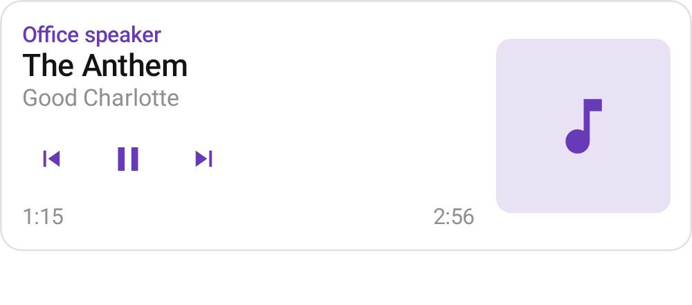
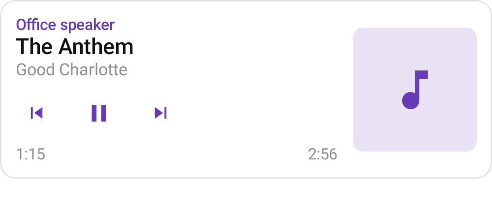
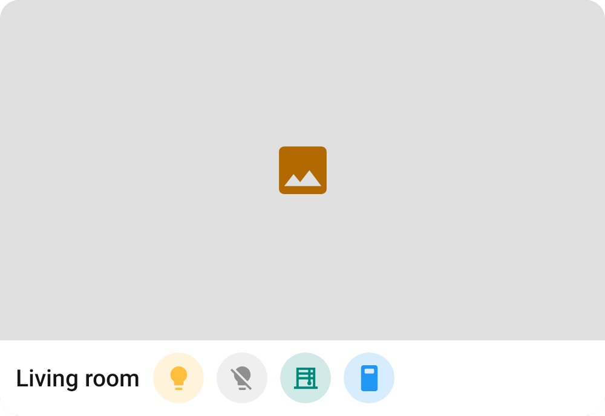
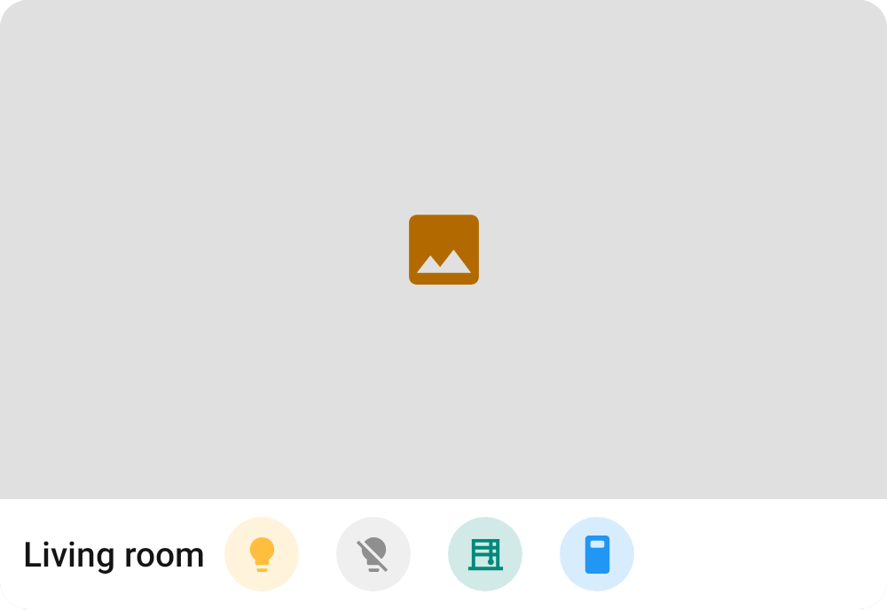

# Disjoint touch targets

After #890 every tappable card part had a 48dp touch target, but neighbouring targets in a row
overlapped over the gap between the drawn controls. The accessibility check counts only a target's
unshared area, so the report on #890 still flagged media transport buttons at 42dp wide (Media
control, its matrix cell and every `UberCards_*` theme) and picture glance cells at 40dp.

The targets now sit edge to edge: the drawn media buttons are 12dp apart (were 6dp) and the picture
glance circles 16dp apart (were 8dp). The first control stays where it was. Renders are the
`previews` module at `widthDp = 381`, light theme; before is main at 6026b677.

| Card | Before | After |
| --- | --- | --- |
| Media control |  |  |
| Picture glance |  |  |

`CardTouchTargetTest` asserts that neighbouring targets in both rows do not overlap.
