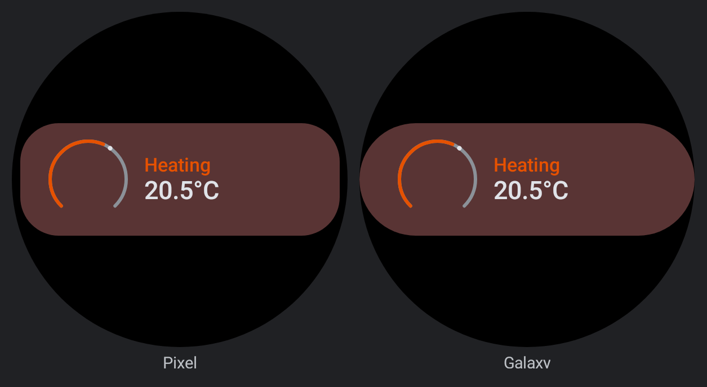
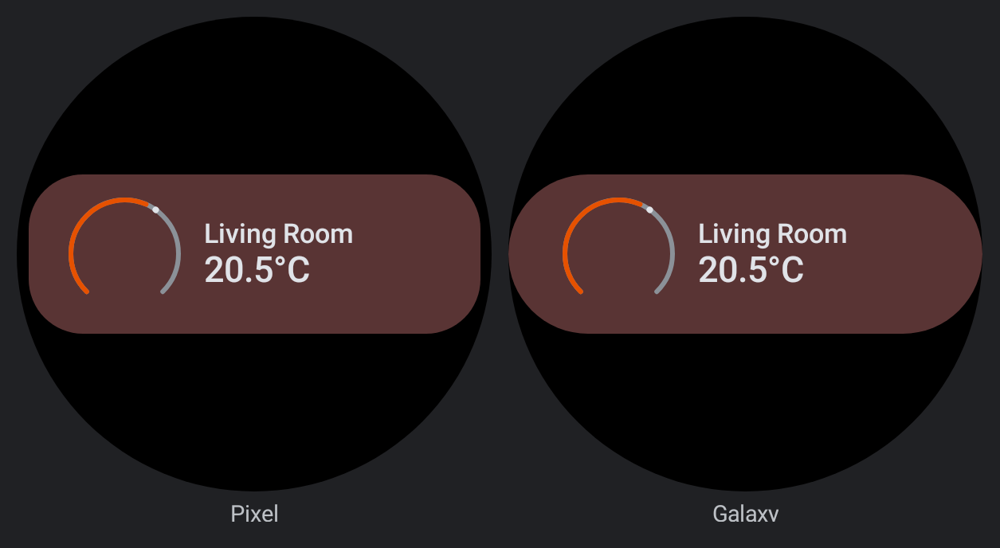
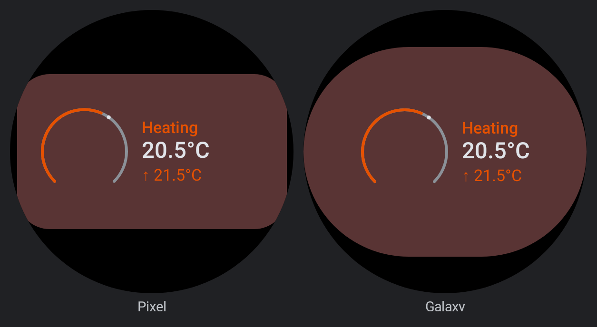
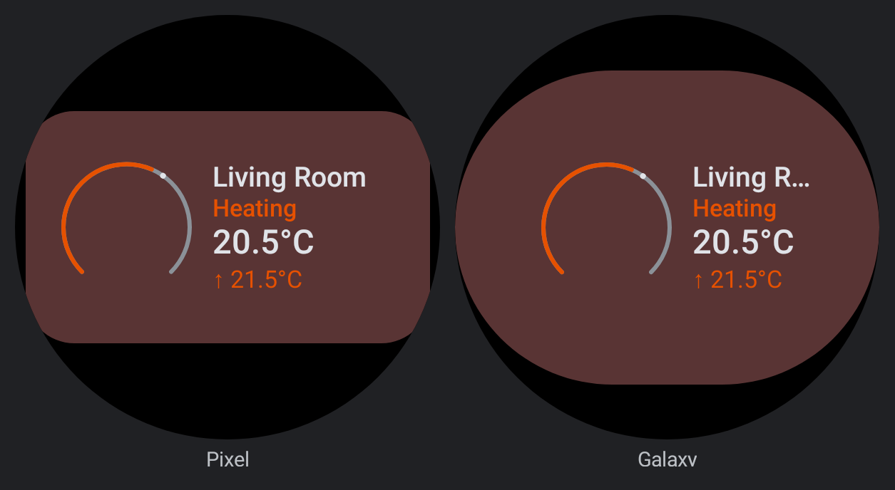
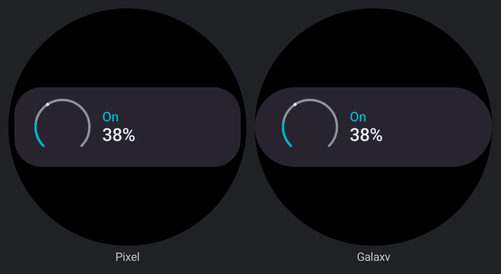
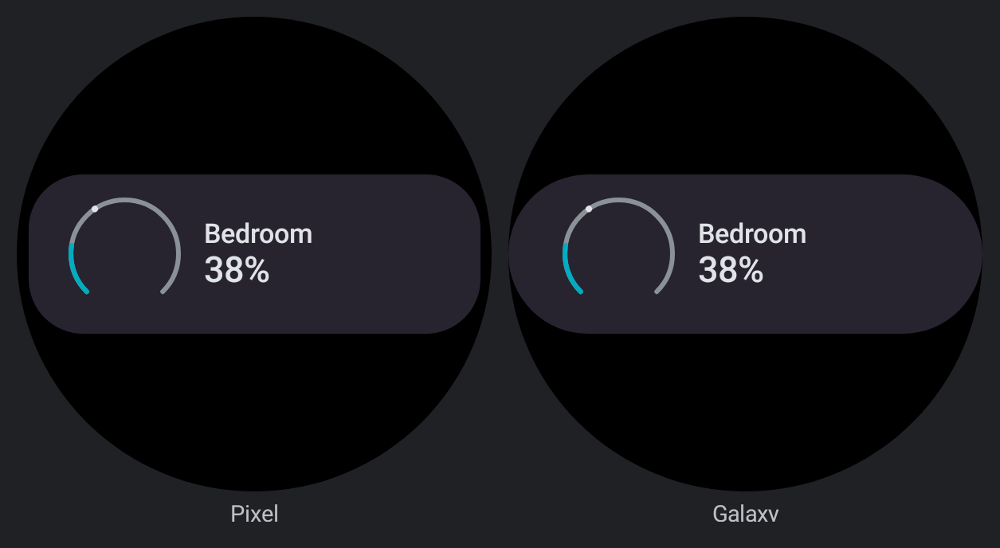
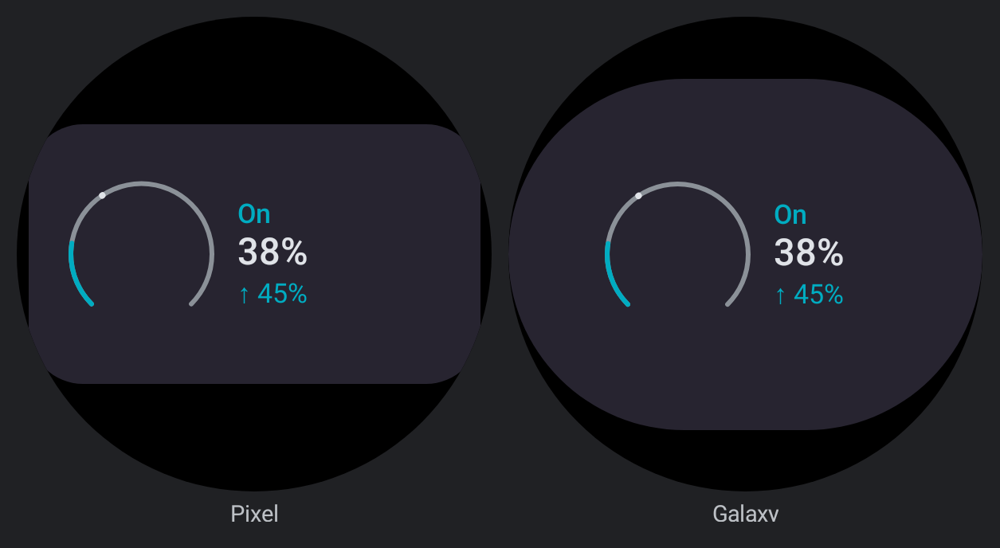
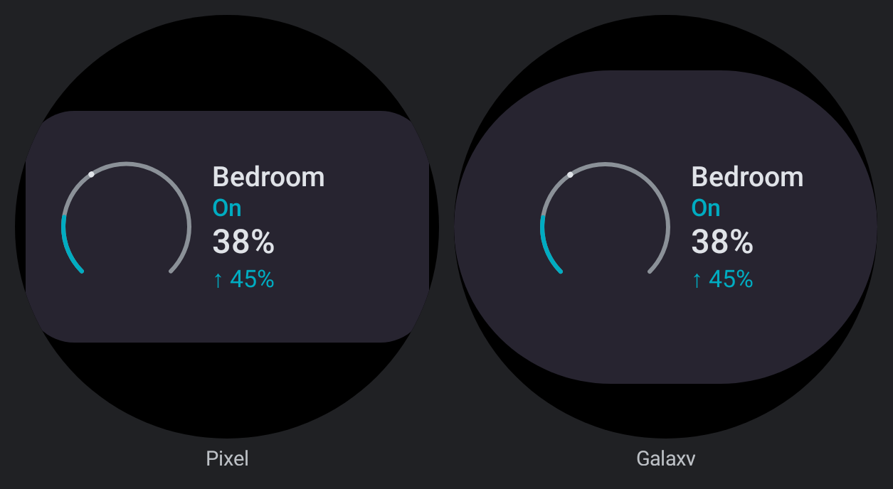
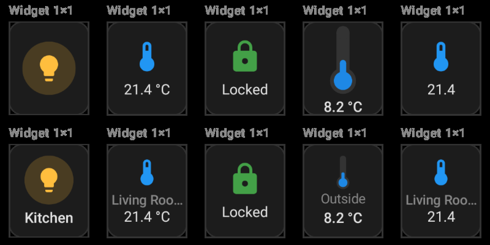

# Card information hierarchy: thermostat, humidifier and 1×1 follow-ups

Before/after renders for the three follow-ups
[card-information-hierarchy.md](../../../architecture/card-information-hierarchy.md) listed: the
Wear thermostat and humidifier showed no name, and a 1×1 launcher widget dropped the name even
under a generic icon.

## Wear: thermostat and humidifier

`wear/` previews in `CardSlotWidgetPreviews.kt`, each on both watch hosts (Pixel, Galaxy).

| Preview | Before | After |
|---|---|---|
| `WearThermostatSmall` |  |  |
| `WearThermostatLarge` |  |  |
| `WearHumidifierSmall` |  |  |
| `WearHumidifierLarge` |  |  |

- **Small:** the dial, then the name over the value (`Living Room` over `20.5°C`). The mode chip
  (`Heating`, `On`) is secondary text and gives its line to the name; the arc's accent still
  shows the mode.
- **Large:** the name is added above the mode chip, value and target. The chip stays because it
  fits and says what the accent cannot: `Idle` in heat mode is still orange, and a humidifier's
  accent is always cyan, `Off` included. On Galaxy's narrower stadium the name ellipsises
  (`Living R…`) before the value does.

## Launcher 1×1

`oneByOne-before-over-after.png` is the `Widget 1×1` cell of `CardPreviewMatrix_Button`, `_Tile`,
`_Entity`, `_Sensor` and `_Statistic` (`previews/`): the top row is before, the bottom row after.

- **Button** (`light.kitchen`, a generic bulb): the chip, a little smaller, then `Kitchen` at label
  size.
- **Tile, Statistic** (`sensor.living_room`): the icon, then `Living Roo…` a type step below the
  state, then the state.
- **Sensor** (`sensor.outside_temp`): the thermometer shrinks to a fixed 30 dp so `Outside` and
  `8.2 °C` both fit. Before, the value was already touching the bottom edge.
- **Entity** (`lock.front_door`): unchanged. The padlock is evocative, so the icon still carries
  the identity alone.

## What else was rendered

All 85 `wear/` previews, all 20 `CardPreviewMatrix_*` previews and the `app/` widget-screen
previews (`Screen_Widgets*`, `ResizeWidgetPreview`) were rendered before and after and diffed pixel
by pixel. Only the four Wear previews above changed, plus these matrix cells:

- the 1×1 cell of Button, Tile, Sensor and Statistic;
- the Wear S / Wear L cells of Thermostat and Humidifier.

`WearGrid*`, `WearHorizontalStack*` and `WearVerticalStack*` are pixel-identical. Cards nested in
a stack or grid keep their icon or dial without the per-entity name (`LocalInCardContainer`).
