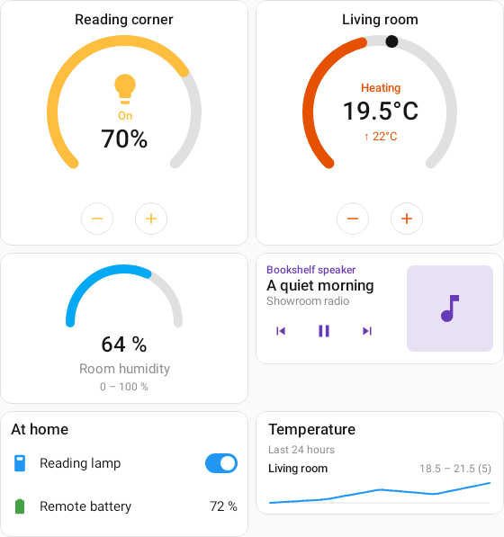
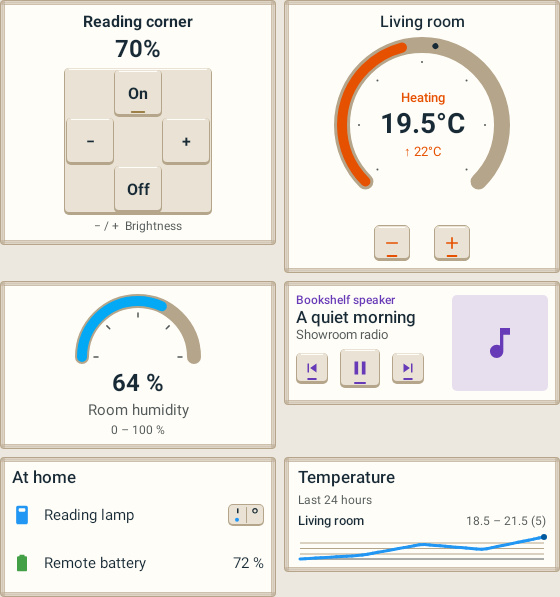
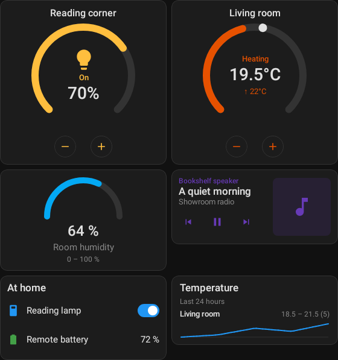
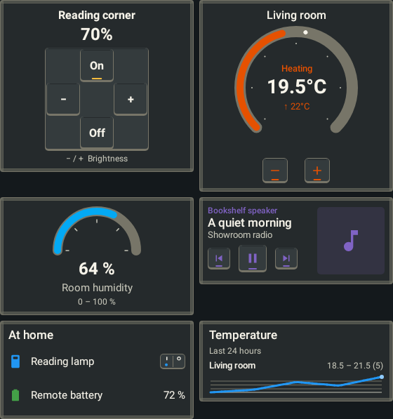

# IKEA Showroom rendered evidence

These are actual RemoteCompose renders with synthetic Home Assistant data. No generated artwork
or mockup substitutes for a running player. Every image is at most 1800px in either dimension.

| Classic baseline | IKEA Showroom, same fixture |
| --- | --- |
|  |  |
|  |  |

The mixed dashboard contains a light, thermostat, gauge, media card, entities list and history
chart. The 560dp capture uses two columns; the 360dp version reflows to one. Separate light
captures show 50%, 90% and Off. Paddle captures show Off, On and unavailable. Gauge captures
push 30 → 75 into the same document; light captures push brightness into the same document.
Explicit On/Off and brightness steps are checked against the real entity rather than a template
slot. Launcher tests check baked values and real actions at 180×80 and 360×290.

- [Phone content, dark](showroom-phone-dark.png), [phone content, light](showroom-phone-light.png)
- [Compact light](light-compact.png), [compact entity](paddle-compact.png)
- [Chromium, 900×1000](browser-desktop.jpg), [Chromium, 390×844 viewport](browser-phone.jpg)

`IkeaDesignRenderTest` uses the actual app Compose Multiplatform player under native-graphics
Robolectric, including the template capture/playback path. The browser harness uses the shipped
TypeScript embed player, with baked `.rc` snapshots exported by the same test. It validates browser
rendering of the documents, not a deployment of the Wasm app or live HA service calls. Browser
screenshots are viewport captures; phone content continues below the fold.

Validation completed: 208 passing tests (80 shared components, 118 converter/parity/template/widget
checks, 5 builder-catalog components and 5 Dashboard Studio checks); `:previews:compileDebugKotlin`;
format checks for all eight changed Kotlin modules; JSON parsing and `git diff --check`.
The final targeted render run passes all three tests. Physical Android/Wear devices and a rebuilt
Wasm website were not exercised. No site, catalog or design-server deployment was performed.

The TS player omits the media artwork/music-note placeholder that the Compose player draws, also
reproduced with the Classic baseline. Text and transport remain visible. This existing cross-player
difference is tracked as [SCH-20](https://linear.app/yschimke/issue/SCH-20/typescript-player-omits-media-control-artwork-placeholder-visible-in); the design does not change generic player layout.
Fonts are host sans-serif, not embedded Noto IKEA; see [design notes](../../ikea-showroom.md).

Reproduce the app-player captures:

```sh
./gradlew :rc-converter:testDebugUnitTest --tests '*IkeaDesignRenderTest' \
  -PlovelaceRenderEvidence="$PWD/docs/design/evidence/ikea-showroom"
```

Reproduce the browser check (only the evidence folder is served, on localhost):

```sh
./gradlew :design-server:embedResources
cp design-server/build/generated/embed/embed/v1/rc-player.js docs/design/evidence/ikea-showroom/
python3 -m http.server 8765 --bind 127.0.0.1 --directory docs/design/evidence/ikea-showroom
# Open http://127.0.0.1:8765/browser.html at a viewport no larger than 1800×1800.
```

The test exports `.rc` snapshots for that harness; these and the copied player are ignored generated
files. The checked-in PNG/JPEG files are the review evidence. Main-branch pipelines publish the
new overview/dial/card previews and values-free design library in the existing catalogs.
