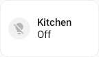
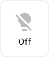
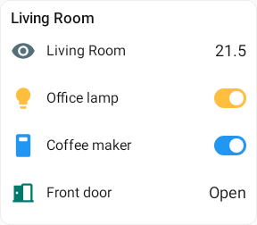
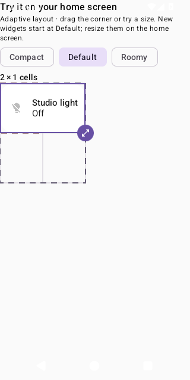
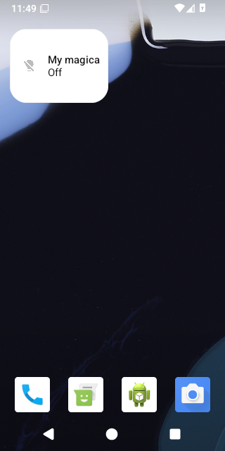
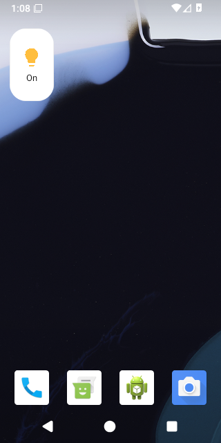

# Launcher 1×1 defaults

These are current-code Robolectric renders, captured at the player device density;
they are not screenshots of an Android launcher or setup sheet. `LauncherDesignsTest`
checks that baked templates and direct captures produce identical pixels.

| Previous default size for single-entity widgets: 2×1 | New default: 1×1 |
| --- | --- |
|  |  |

The larger tile reveals the name; the one-cell tile keeps its icon and live state.
The 2×1 image demonstrates the previous default dimensions using the current renderer.
Every card now uses one provider with a 1×1 default and no app-imposed maximum.
The setup preview samples up to 4×4; actual resize limits belong to the launcher.

| One-cell entities list | Expanded list on resize |
| --- | --- |
|  |  |

A one-cell list shows its first entity's icon and state. Resizing reveals additional
entities and their controls. Wear layouts are unchanged.

Verification: 35 focused unit tests passed (`WidgetSizingTest`, `LauncherDesignsTest`,
`EntitiesSizeTiersTest`, `TileFeaturesCaptureTest`), as did
`:app:compileDebugAndroidTestKotlin` and repository-wide `ktfmtCheck`.
`WidgetPreparationTest` includes fresh-install 1×1 assertions, a real launcher resize
gesture, saved-card retention, selection restoration and screenshot collection.
The initial sizing revision `405494da` passed the native Android 16 suite in
[run 39129813511](https://github.com/yschimke/homeassistant-remotecompose/actions/runs/39129813511).
It verified installation at 1×1, the real launcher resize gesture, preserved card
configuration and setup selection restoration. The single-provider consolidation
will run the updated 4×4 preview checks in CI as well.

## Native baseline

These before screenshots come from the successful main-branch
[Android 16 CI run 39124461910](https://github.com/yschimke/homeassistant-remotecompose/actions/runs/39124461910),
artifact `android-test-reports` (12135966038). The setup preview opens at 2×1 with
Default selected and the old installation copy.

## Native installation and real resize

These Android 16 screenshots are from revision `405494da`, artifact
`android-test-reports` (12136953951). The subsequent provider consolidation keeps
the same 1×1 content and responsive renderer, removes the duplicate components and
allows resizing beyond the former card-specific caps.

| Before: previous 2×1 installation default | After: 1×1 installation | Real launcher resize |
| --- | --- | --- |
|  |  |  |
