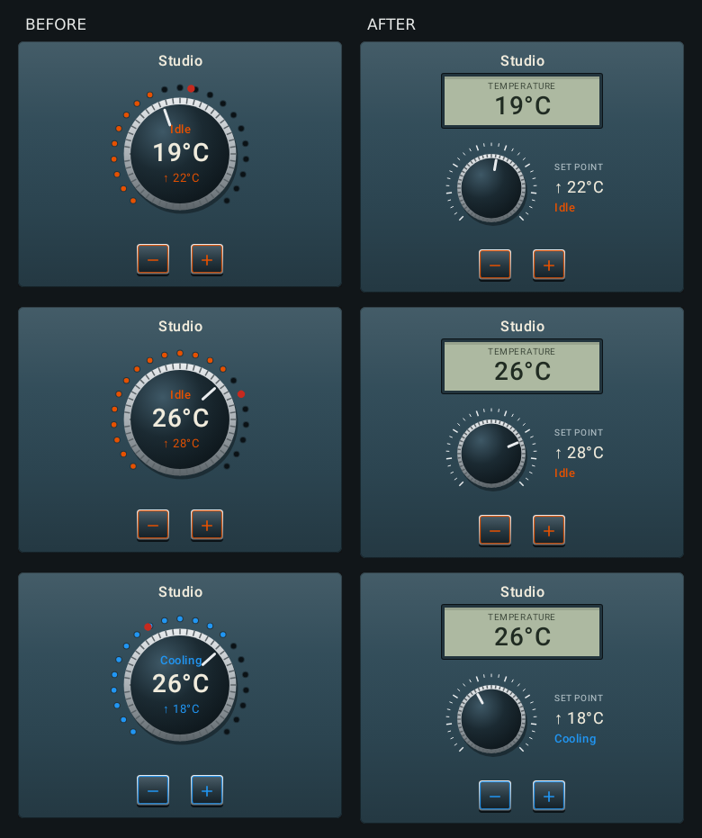

# Console thermostat hardware

The thermostat previously overlaid room temperature, HVAC status and target text on a rotary cap,
with a filled LED ring and a travelling target light. The cap pointer followed the room sensor.

The Console thermostat now has a separate recessed monochrome temperature window and a plain
knurled knob below it. A stationary printed scale replaces the LED ring. The knob's white index
follows the requested temperature. The target and HVAC status sit alongside the control, and the
existing minus/plus keys retain their actions. A thermostat without a target parks at the low stop
and displays a dash. Light and humidifier dials retain their own existing designs.

These are local captures from the app's RemoteCompose player, generated by
`ConsoleDesignRenderTest.thermostatSeparatesRoomReadingFromSetPointKnob`. `before/` uses the merged
PR #895 component sources; `after/` uses this change. Both use the same fixture and player.
The after captures also cover a 260 dp card and a 180 × 80 dp Fixed-mode surface.
All images are below 1800 px on either side.

## Live data contract

| Part | Update path |
| --- | --- |
| Temperature window | Existing `current_temperature_label` binding; builder uses its existing climate current-temperature float expression |
| Target label | Existing `temperature_label` binding; builder uses its existing target-temperature float expression |
| Knob index | Existing `target_fraction` binding, or builder's live target fraction; absent builder targets park via `targetVisible` |
| HVAC status/accent | Existing mode label and accent bindings |
| Scale and cap | Static physical material, with no text overlaid on the moving cap |
| Minus/plus keys | Existing actions, rebuilt from the live set point by the template playback |

The thermostat converter retains its `dataSignature` re-encode path, including structural changes
when the target disappears or returns. No new binding suffixes or host requirements are introduced.
The same component treatment reaches the `ha-cards/thermostat` builder.

The render regression pushes 19 → 26 °C into the same document with a fixed 22 °C target: the
separate reading changes while the knob pixels stay identical. Changing the target to 28 °C moves
the knob index. This regression fails against the previous component sources. The launcher test
checks that both compact and full Console thermostats bake all climate slot bindings, and that
full-size keys retain real-entity `set_temperature` actions with 21.5/22.5 °C payloads.
