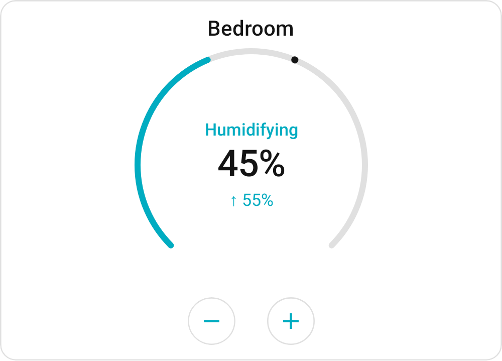
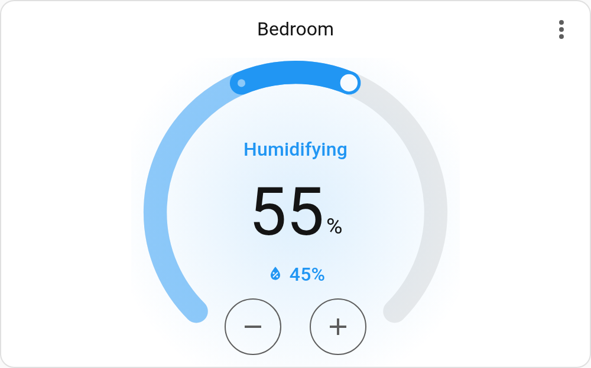
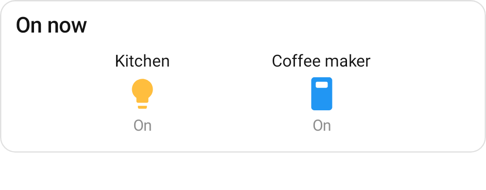
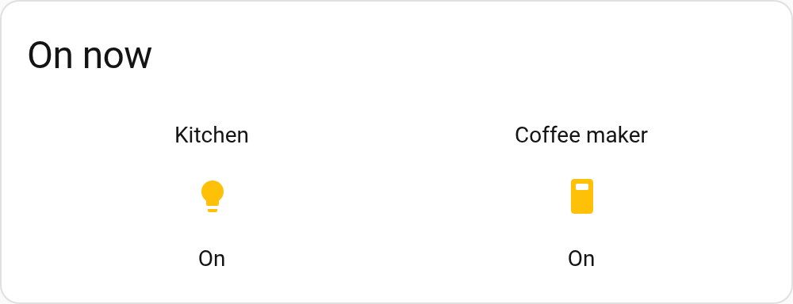
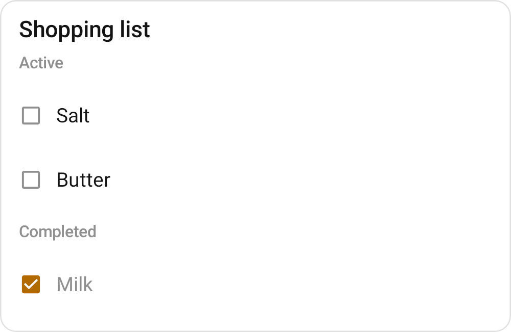
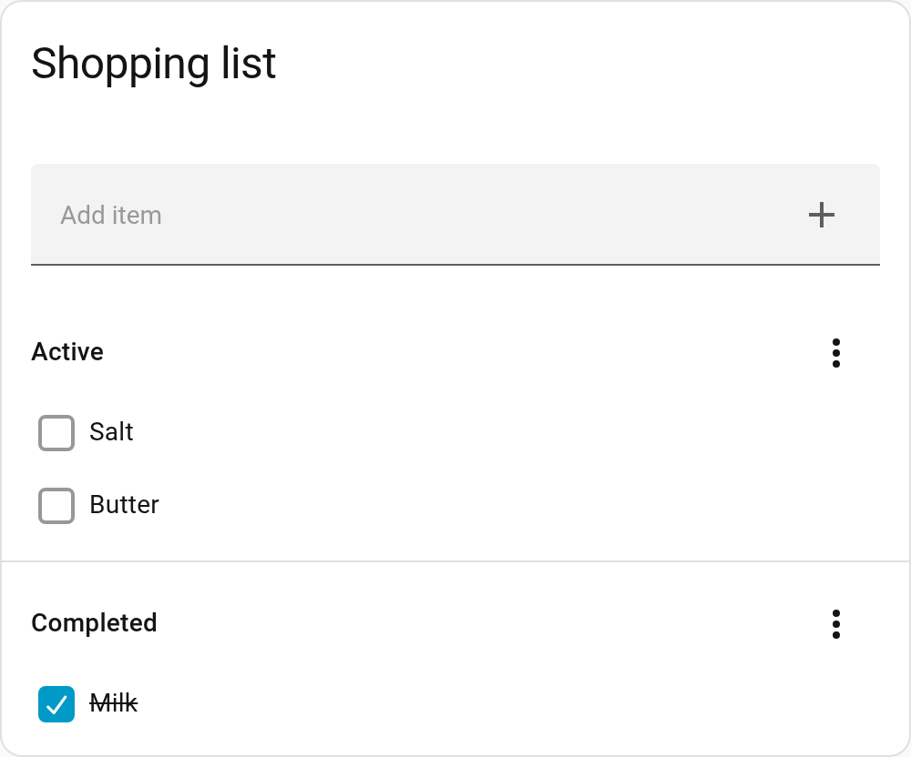

# Pixel-diff references for humidifier, entity-filter and todo-list (#101)

Each new `CardPixelDiffTest` case compares an RC preview render with a crop of the same card in the
seeded Home Assistant (`integration/compose.yaml`). These are the light renders the cases compare,
at the previews' new 381 dp widths; the references they are compared with are under
`references/humidifier/`, `references/entity-filter/` and `references/todo-list/`.

| card | render | reference |
| --- | --- | --- |
| humidifier |  |  |
| entity-filter |  |  |
| todo-list |  |  |
