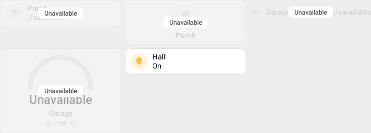
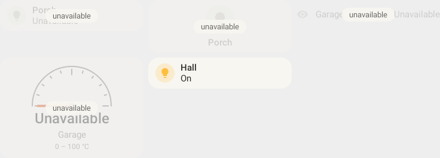
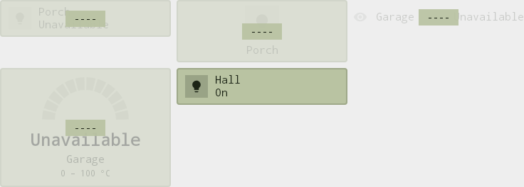

# Unavailable entities: one treatment per uber theme

A card about one entity (`entity:`) shows that the entity is unavailable the way its uber theme does, the same for every card type. The theme sets the style (`HaUberTheme.unavailable`, `HaUnavailableStyle`):
- the content fades;
- the theme's label is stamped over the middle in the theme's type, in clear but partly transparent lettering on a plate of the card's own surface.

The available Hall tile in each sheet is untouched.

| Theme | Label | Sheet |
|---|---|---|
| Classic (the default) | "Unavailable" |  |
| Braun | lowercase "unavailable", regular weight |  |
| LCD | "----", in the display's ink |  |

Rendered by `UnavailableFrameCaptureTest`. The cards are a tile, a button, an entity card and a gauge of unavailable entities, then an available tile.
