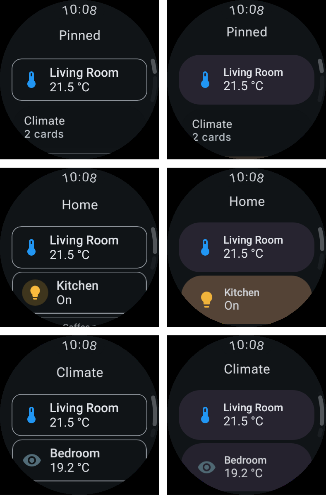

# Wear app cards in their widget's frame

The Wear app draws each card exactly as its Wear widget draws it, so a card added as a widget looks
the same on the watch face as it did in the app (`WearRemoteCard`):

- **Container.** Small for a card whose data fits only the small container (`WearCardDataTier`) or
  whose natural height is one row (80 dp or less, the cards' own Small/Large cut), Large otherwise.
- **Frame.** The size, padding and corner radius this watch's widget host last gave a widget of that
  container (`WearWidgetFrame`, kept from each widget's `WearWidgetParams`). Before any widget has been
  added, Glance Wear's preview values for a round watch: 200×60 and 200×112 dp, 8 dp padding, 26 dp
  corners.
- **Document.** The widget's container-neutral template (`neutralWidgetTemplate`), with the frame's
  named values filled in (`WearWidgetTemplate.forApp`) and the card's state tint as its fill. The
  widget bakes its values; the app plays the same template's bindings, so values stay live.

A light that is on is now captured on (`WEAR_ON_PROPERTY`): the Wear tile tiers resolve their icon
when captured, so a template from the off placeholder showed an on light's bulb unlit, in the
widget and in the app.

Left: main (phone-style outlined cards). Right: this change. Rendered from `WearPreviews.kt` on
`SMALL_ROUND`: `WearTopLevelPreview_Live`, `WearDashboardPreview` and `WearSectionPreview`.

