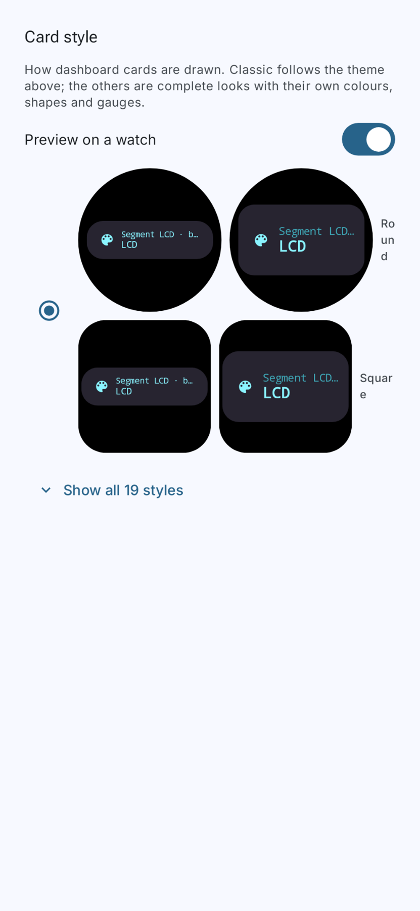
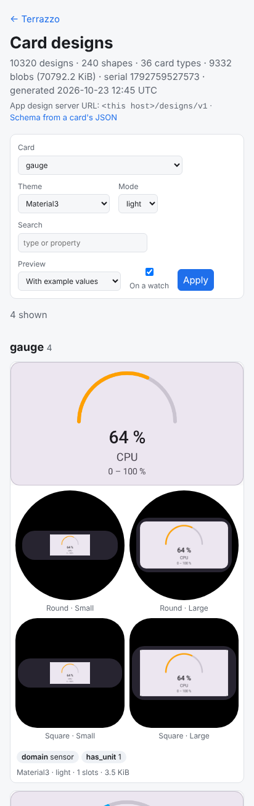
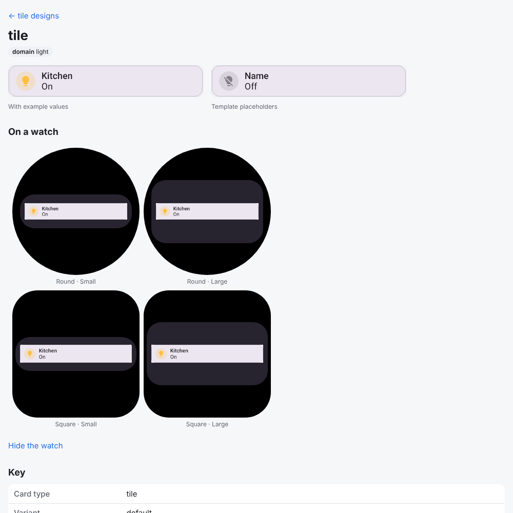

# Library designs on approximate Wear watch screens

An opt-in view of how a design would look as a Wear widget: on a round and a square watch screen,
in the Small (200×60 dp) and Large (200×112 dp) containers a watch's widget host draws (26 dp
corners, 8 dp padding, its default surface). It's an approximation for judging a design, not a Wear
render: the watch keeps its own palette and card style, each host has its own container sizes, and
a card's Wear tiers can lay it out differently.

- **Phone, Settings → Card style → "Preview on a watch".** Each style's sample card drawn as the
  watch draws a widget (Fixed size, no card chrome of its own, height breakpoints, dark), so the
  Small container shows the compact tier (`CardStyleWearPanes`).

  

- **Design server, ha.coo.ee/designs, "On a watch" (`wear=1`).** Each design's existing preview image
  is framed in CSS on the four screens, on the browser and on a design's page. At phone width the
  filter form no longer pushes the page wider than the screen.

  
  
