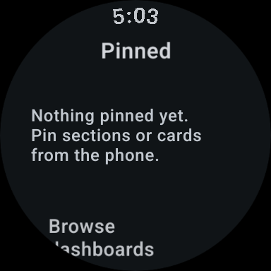

# Wear quality sweep — supplemental rendering evidence

These are screenshots of **real Glance Wear documents played by the native
Robolectric/CMP test player**, not generated artwork. They are **not screenshots
of installed system-host widgets** and do not prove installation or pinning.
Device/emulator installation and representative app screenshots remain pending.

All use offline demo temperature data (`Living room`, `21.5 °C`), the watch's
Material 3 fallback palette, and the built-in local design library. Author/variant or
device-specific server designs are not involved. Pixel dimensions equal dp in
this test environment; every image is below 1800 px in either dimension.

| Design/style | Surface/size | Screenshot |
| --- | --- | --- |
| Braun tuning-scale sensor | Small, 200 × 60 dp | [Braun](native-player-braun-small.png) |
| Material 3 Expressive sensor | Small, 200 × 60 dp | [Expressive](native-player-expressive-small.png) |
| LCD segmented sensor | Large, 200 × 112 dp | [LCD](native-player-lcd-large.png) |
| Console fader sensor | Large, 200 × 112 dp | [Console](native-player-console-large.png) |

Visual review: each shows the current reading and room name without clipping;
the reading has clear contrast and the instrument is centered vertically.
The small sensor previously selected an empty history panel whose text clipped
at the bottom. Wear now uses the shared compact typed measurement, retaining
its live state and numeric bindings. History is not carried by the Wear wire
schema.

`SlotWidgetDesignTest.alternativeStylesBakeFreshReadingsAtBothWearSizes` captures
all seven styles at both sizes, validates their operation profile, checks that
changed values are baked and entity-slot bindings are resolved, and plays the
documents to produce the source images in `wear/build/wear-designs/`.

The same suite checks that changing or clearing a phone style changes/restores
the template, and compares cached versus fresh host geometry by rendered pixels.
Separate phone tests cover card/type override precedence and additive wire
compatibility; Wear tests cover missing/unknown style fallback and stale-data
ordering.

Verification passed: `:wear:assembleDebug`, `:wear:testDebugUnitTest` (17 tests),
`:wear:compileDebugAndroidTestKotlin`, `:wear:lintDebug` (0 errors, 34 warnings),
and `:app:testDebugUnitTest --tests '*WearCardStyleSyncTest'` (4 tests). The
navigation instrumentation APK also builds, and formatting checks pass for
`wear`, `app` and `rc-converter`. Instrumentation has not run on a device.

## Runtime limitation

This Hive VM initially had no JDK, SDK, ADB, device, or emulator. A JDK and SDK
were provisioned and the Wear APK was built. The Wear OS 7/API 37 x86_64 image
was downloaded, but the emulator refused startup with:

    FATAL | Your device does not have enough disk space to run avd: `wear-qa`.

The VM has a 10 GB root disk and no `/dev/kvm`. Downloaded
emulator files were reclaimed so build/regression verification could proceed.
No physical-device testing is claimed. Core navigation instrumentation tests
have offline fixtures, but running them and exercising the actual widget picker
requires an available Wear runtime. The production widget capability gate is
API 37; an older Wear emulator would not prove widget installation.

After verification, temporary Gradle caches were reclaimed and the system image
was placed in the emulator process's RAM-backed temporary storage. With a local
X11 dependency supplied, the emulator passed disk preflight and began a full
software-emulated boot at 384 × 384 px. ADB readiness is being monitored; the
device is still offline at this checkpoint. System-host installation and app
screenshots remain unfinished.

On resuming after the agent process was killed, the saved test reports and both
APKs were intact. The existing emulator process was still running, with about
20 minutes of active CPU time, but ADB still reported `emulator-5554 offline`.
Reconnecting the offline transport did not restore it. Two bounded console
screenshot attempts failed with `received: (0x0)`, so no usable emulator frame
was available. Installation, pinning, navigation instrumentation and persistence
in the real widget host remain unverified. Boot monitoring remains active.

Wear widgets currently have no tap actions. Server variant, author, publishing
and device-match selection remain mobile features; the new wire field carries
only explicit card/type **style** overrides. Missing or unrecognized overrides
inherit the watch-wide style. The watch still owns the widget palette.

## GitHub CI runtime evidence

[Run 39051677625](https://github.com/yschimke/homeassistant-remotecompose/actions/runs/39051677625)
booted the Wear OS 7/API 37 small round emulator with KVM, installed the app,
and captured this actual activity frame at 384 × 384 px:

The pinned landing page is readable; the dashboard entry continues below the
round viewport in its scrollable list. This is the initial empty state, not an
installed widget or a before/after comparison. All three instrumentation tests
failed during Espresso initialization with
`NoSuchMethodException: android.hardware.input.InputManager.getInstance`.
The test runtime now explicitly requests Espresso 3.7.0, which includes the
[upstream API 37 compatibility fix](https://github.com/android/android-test/issues/2507).
Navigation assertions and system widget installation remain unverified pending
the next run; the original local VM boot limitations above describe earlier attempts.

Hive session: https://hive.codes/?session=session-1792140217260-d26d7d
