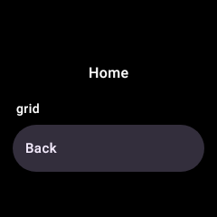
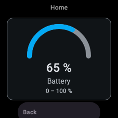
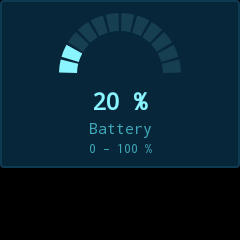
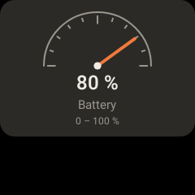
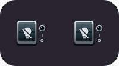
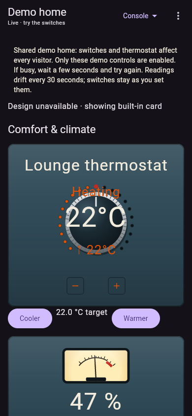
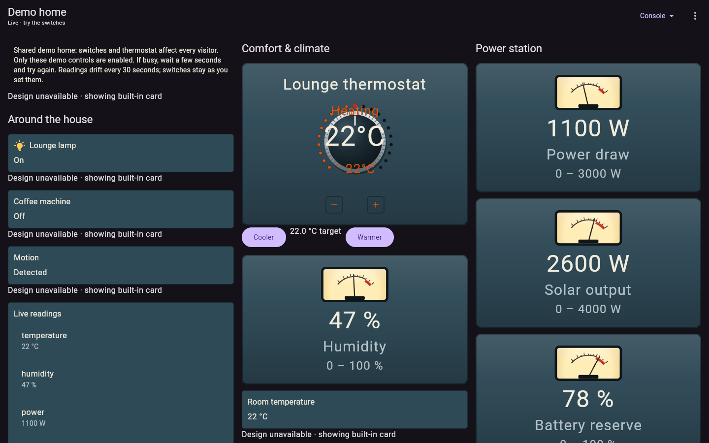
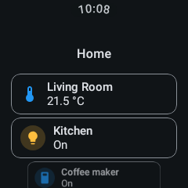
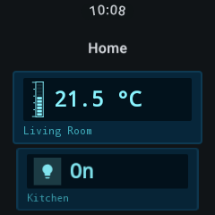
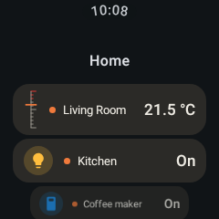

# Wear selected designs and dashboard containers

Investigated against main `c6ae9a847542dc946ee1bee51a9f6b2233813673`, with the checked-in
Remote Compose alpha21, remote-material3 alpha13 and Glance Wear alpha20 dependencies.

## Root cause

The Wear activity's dashboard, pinned-section and pinned-card screens rendered `CardSummary`
as ordinary text. They never decoded `rawJson` or invoked a card converter/player. The phone's
summary of an untitled grid uses `grid` as its title; Wear printed that title and no children.
Consequently both reported activity symptoms share a cause. This is separate from Glance Wear
system widgets, which already capture and play styled card templates.

The activity now decodes the original config and plays local Remote Compose designs using the
shared converter registry and Compose player. Grid/stack conversion, conditional visibility and
live template bindings follow the same paths as the phone. It waits for the persisted watch style
and palette before its first capture. The document identity includes style and baked/structural state;
named values seed current data before playback, including cached replay. Message editing uses
its existing native control and gated sender in dashboards, sections and top-level pins.

Phone explicit card/type style overrides already accompanied individual pins, but did not accompany
sections or dashboard cards. All three now use the same resolver, matching overrides against the original config before
Bambu device resolution rewrites it. Section and dashboard publication
observe override changes, including clearing an override; dashboard publication also retries after
Wear API recovery. The wire field is unchanged and survives the existing offline stores.

## Form-factor audit

| Surface | Selection and caching | Result |
| --- | --- | --- |
| Android phone/tablet | `CardDesignPreload`, `cardTemplateFor`, `CachedCardPreview`; author/server/variant changes discard old selections, style is in template/cache keys | Existing selection path retained |
| Android launcher widgets | `LauncherLook` resolves explicit override then phone style; template key contains look; settings/overrides refresh placed widgets | Existing fixed-profile design/converter fallback retained |
| Wear activity | Previously summary text, now `WearRemoteCard`; explicit phone style overrides watch style; raw config and style persist offline | Fixed |
| Wear system widgets | `slotWidgetData`, style/container/theme keyed templates, baked live values; watch settings and pin changes trigger updates | Existing constrained-profile path retained |
| Desktop/Wasm live dashboard | `LibraryDesignKey` includes style/mode/exactness; cache recreated for server changes; exact shapes required, unsupported controls stay native | Missing/incompatible design fallback now labeled |
| Desktop/Wasm demo | `LibraryCard` replaces bytes on design-key changes | Fallback now inherits selected theme chrome and reports unavailable designs |
| TV kiosk | Own `TvPrefs.cardStyle`; `KioskCardKey` includes style and data signature; shared converters/player | Existing local selection retained |
| iOS | Gateway chooses document URL; client downloads/caches that identity, with recorded demo documents | Clear old bytes when a refreshed manifest changes the document URL or removes a card; failed fetch cannot leave the previous design under the same card id |

Native fallback chrome cannot reproduce a missing design's custom instrument artwork. The notice
makes this distinction visible. Intentional shared-host native controls, picture handling and
unsupported-operation checks are preserved.

## Boundaries requiring product decisions

- Watch-wide style is independent of phone-wide style; explicit phone card/type overrides win.
  This preserves the documented precedence. Automatically mirroring the phone-wide style would
  change that product behavior.
- Phone server variants, preferred authors and device-specific designs are not part of the Wear
  protocol. This change does not claim to transfer those documents, nor force mobile documents
  into the restricted Glance Wear profile. Their transfer, compatibility policy and fallback
  presentation need a separate selection contract.
- Generic card service actions are not transported by the existing Wear sync protocol. The
  activity has no general `HaActionDispatcher`, and widget capture does not supply a service-action
  bridge. These are display/live-state checks, not proof of tappable Home Assistant controls.
  Existing native message input remains supported. Adding general action delivery needs its own
  foreground/offline/confirmation contract.
- Wear still receives the existing reduced entity payload (not forecasts/history or full climate
  data). Rendering cannot restore unsynced data. Existing small-slot/data-tier decisions remain.
- iOS has gateway document selection rather than the Android style picker. The cache fix relies
  on changed document URLs to identify changed designs; a gateway replacing bytes at the same URL
  cannot be distinguished from a transient offline refresh.

## Verification

The regression was run against the original `WearDashboardsScreen` from the main revision
above with the current dependency set and new test harness. It failed because `grid` was present;
restoring the fix passes and renders the child gauge. This was a targeted baseline reproduction,
not a separate pristine checkout of every module.

Executed locally:

- Full Wear unit/Robolectric suite: 34 tests passed, including actual native-graphics playback.
- Full phone unit suite: 186 tests passed initially; all 10 focused Wear style/Bambu sync tests
  passed after the review fixes.
- Shared desktop JVM suite: 44 tests passed, including the new Compose fallback/theme test.
- Focused shared converter/player tests: 25 passed (`FirstFrameLiveValuesTest` and
  `LauncherDesignsTest`), including actual launcher-widget playback and first-frame values.
- TV and Wasm Kotlin compilation passed.
- CI executed the iOS stale-design test successfully, built the iOS app, and passed Wear OS 7
  instrumentation, Android instrumentation, desktop installers and the full unit-test job.
- Wear lint passed after the configuration-aware density fix.
- The full public demo browser script passed against the CI-built Wasm bundle, including
  exact missing-design notices, live instrument values/actions, resize and offline recovery.
- Formatting checks passed for app, Wear and shared UI; `git diff --check` passed.

Regression coverage includes:

- Wear dashboard must not render a text node `grid` for a real grid config.
- Actual rendered pixels change with watch style, phone override and live nested gauge values;
  replay after disposal shows the current value, and clearing an override restores watch style.
- Style serialization and override resolution for pins, sections and dashboard summaries.
- Wear Widgets at 200×60 and 200×112: all built-in styles capture and play with current baked
  readings. A grid loaded through fresh `WearOfflineStore` instances follows persisted watch
  selection, explicit override, live child updates and clearing the override. Documents validate
  against `WEAR_WIDGETS`; rendered frames are inspected below. Small controls intentionally omit
  labels at these sizes.
- Shared-host missing design notice and selected fallback theme after a style change.
- iOS manifest switching a card to an unavailable design clears the previous document.
- Font-scale changes refresh Wear artwork; pinned message inputs reach the gated sender;
  device resolution preserves card-specific Bambu styles.

### Visual evidence

All Wear images are actual test captures, at most 240×240. The Wear activity is rendered in a
Robolectric native-graphics Compose host; widgets are captured by Glance Wear and played by
`HaRcComposePlayer`, not photographed on a watch.

| Main screen before | Fixed screen |
| --- | --- |
|  |  |

| Watch LCD | Phone Braun override, updated live value |
| --- | --- |
|  |  |

| Small LCD grid, on | Same offline widget, updated off |
| --- | --- |
|  |  |

| Large Braun grid | Large Console grid | Small LCD reading |
| --- | --- | --- |
|  |  |  |

### Browser evidence

Real Chromium screenshots of the CI-built shared host, with the test server deliberately
returning missing designs for non-instrument cards:

| Phone layout | Wall layout |
| --- | --- |
|  |  |

### Verification limits

No paired watch/phone or Wear OS system widget host was available. Data Layer delivery, widget
picker placement, system-host playback and physical tap behavior need device verification. TV
was compiled and audited, not run on a TV. iOS tests require macOS/Xcode and passed in CI, including the new stale-design regression. Desktop shared Compose behavior was tested, not a complete signed-in desktop
session. The public demo browser flow is also checked against the CI-built Wasm bundle.

No upstream workaround was removed: Glance FlowLayout fallback, fixed-canvas breakpoints,
AndroidX wrap capture/measurement handling and player capability fallbacks remain intact.

A separate pre-existing iOS cache/account-isolation issue was tracked as
[SCH-44](https://linear.app/yschimke/issue/SCH-44/scope-ios-offline-card-documents-and-manifests-to-the-gateway):
two gateways using the same relative document URL share a cache key. It needs a server/account
namespace and migration policy, independently of the within-feed document-identity fix here.

## Published Wear preview fixtures

The original screen previews supplied title-only summaries without `rawJson`. Once the activity
started rendering real cards, those fixtures correctly hit the unavailable-config fallback.
They now provide complete card configs, and the regression test calls the published dashboard,
section and pinned-screen preview functions directly. Explicit LCD and Braun variants verify
selected artwork rather than only the default style. These are native-graphics captures of those
functions; CI also republishes their round-watch preview images.

| Classic | LCD | Braun |
| --- | --- | --- |
|  |  |  |
