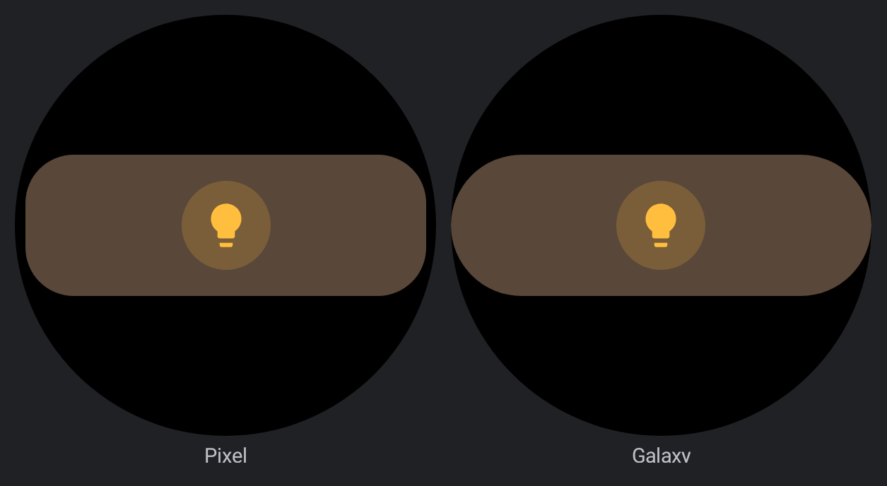
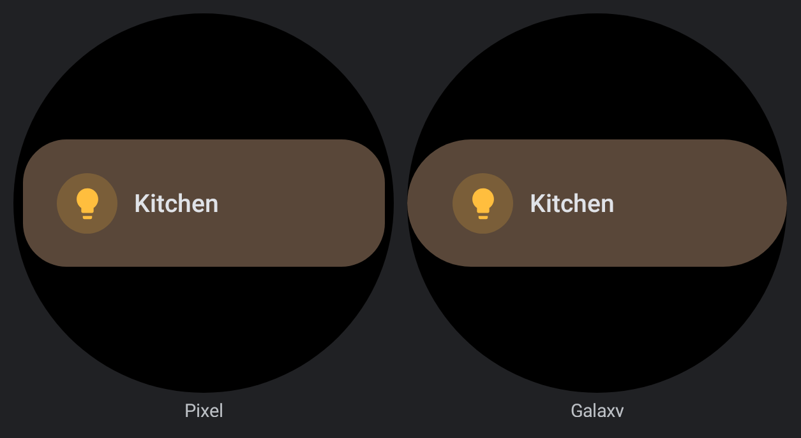
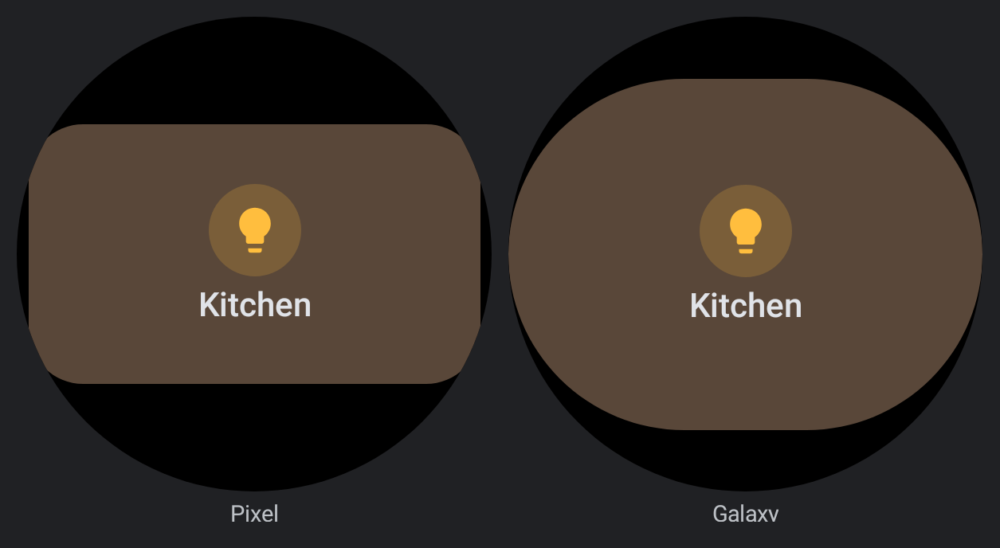
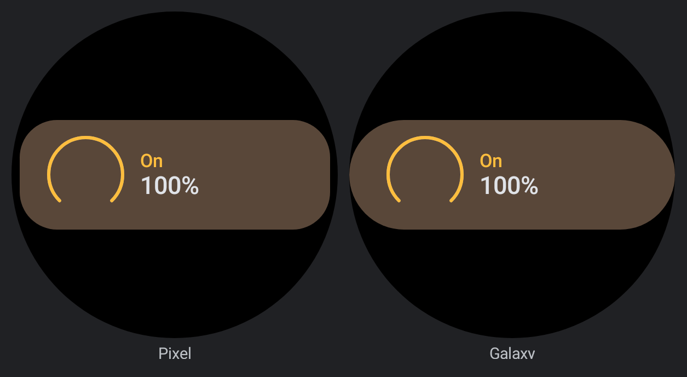
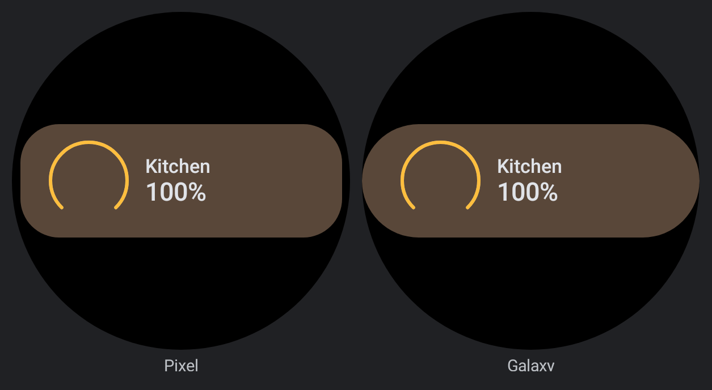
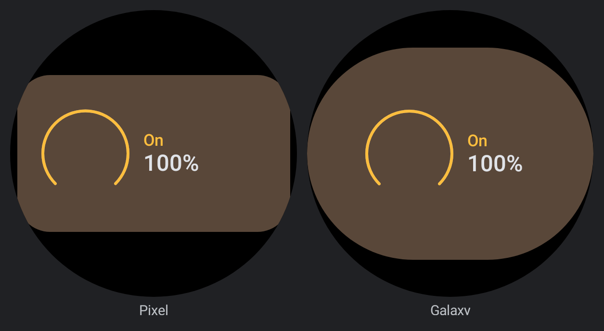
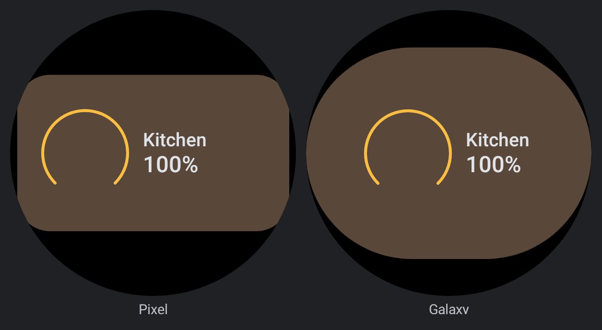
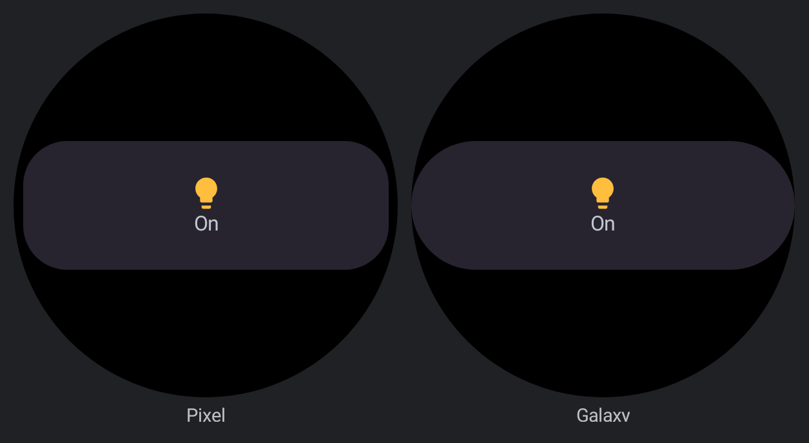
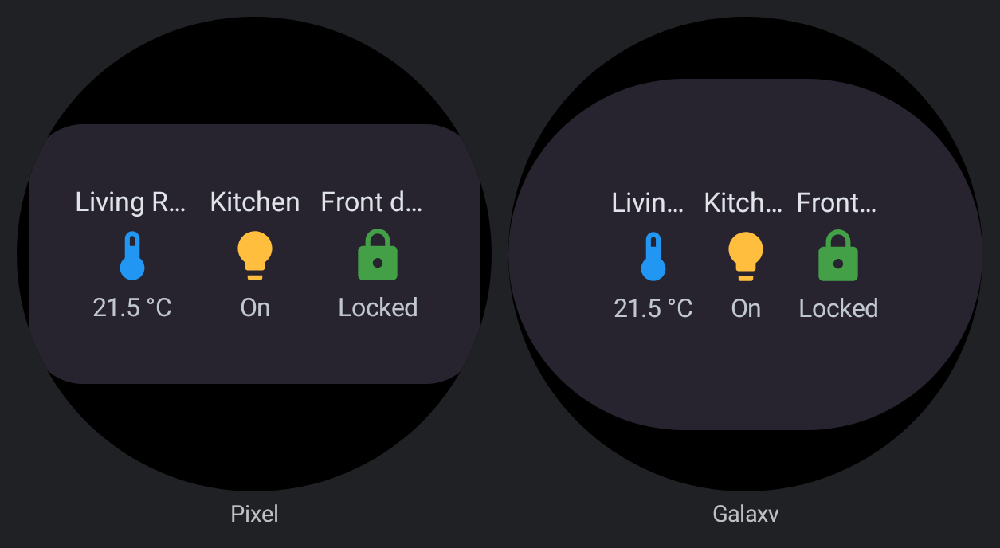
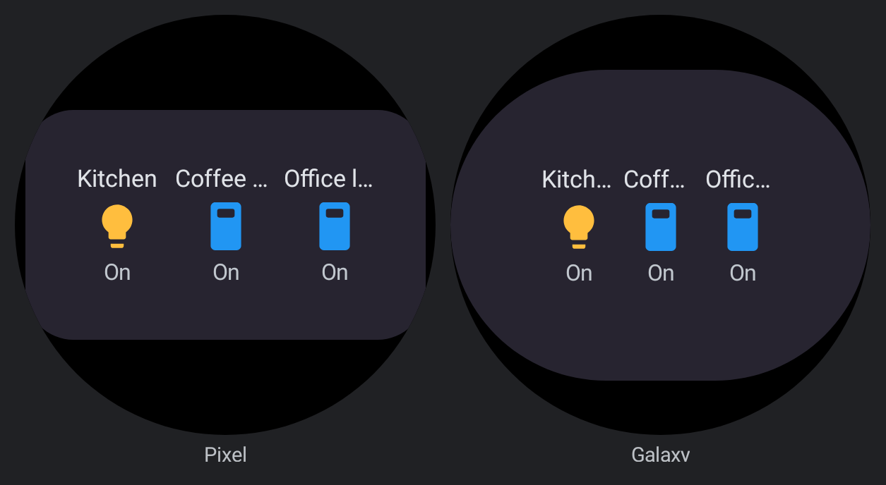

# Wear Small widgets name their entity

Renders of the `wear/` previews in `CardSlotWidgetPreviews.kt`, before and after, each drawn on
both watch hosts (Pixel's squircle, Galaxy's stadium). The rule they follow is
[card-information-hierarchy.md](../../../architecture/card-information-hierarchy.md): a
single-entity card keeps its name down to the Wear Small container.

| Preview | Before | After |
|---|---|---|
| `WearButtonSmall` |  |  |
| `WearButtonLarge` (unchanged) |  |  |
| `WearLightSmall` |  |  |
| `WearLightLarge` |  |  |
| `WearGlanceSmall` (unchanged) |  |  |
| `WearGlanceLarge` (unchanged) |  |  |
| `WearEntityFilterSmall` (unchanged) |  |  |
| `WearEntityFilterLarge` (unchanged) |  |  |

- **Button, Small:** the bulb alone became the tinted chip, then `Kitchen` (and the state with
  `show_state`), on one line. Large keeps the full button.
- **Light, Small and Large:** the `On` mode chip, which repeats what `100%` / `Off` already says,
  gives its line to the name: `Kitchen` over `100%` beside the dial.
- **Glance and Entity-filter:** unchanged. Multi-entity cards keep their icon-over-state cells in
  Small, with no per-entity names; the fixtures have no title, and a title is not forced in.

`reference-TileSmall.png` and `reference-EntitySmall.png` are the two cards that already named
their entity in Small, the style matched here.

`matrix-button-light-before-after.png` is the top of `CardPreviewMatrix_Button` and
`CardPreviewMatrix_Light` in `previews/` (before over after, each pair): only their Wear S / Wear L
cells change; the app and launcher cells are pixel-identical. The button matrix fixture uses
`show_state`, so its Small row ends in `On`.
