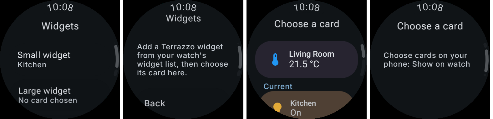

# Wear widgets choose their card on the watch

The phone chooses what the Wear app shows ("Show on watch", ordered in "Cards on your watch"). It no
longer assigns cards to widget slots. On the watch, each Terrazzo widget chooses one of those cards:

- **Two providers.** One Small and one Large widget provider replace the ten slot services. They are
  enabled on Wear OS 6 (API 37) once the phone has sent a card.
- **Per widget.** The card is kept per Glance Wear widget instance (`WearWidgetCardStore`). A copy of
  the card is kept, so a widget keeps drawing a card the phone later stops showing.
- **Choosing.** From the Glance Wear configuration activity (`WearWidgetConfigActivity`), when the
  watch's host launches it on adding a widget, and from the Wear app's **Widgets** screen, which lists
  the placed widgets.
- **Empty.** A widget with no card chosen yet says "Choose a card in the Terrazzo app". Wear widgets
  can't launch an activity from a tap.

Left to right: the Widgets screen, with no widgets placed, the card picker, and the picker with no
cards synced. Rendered from `WearPreviews.kt` on `SMALL_ROUND`.

