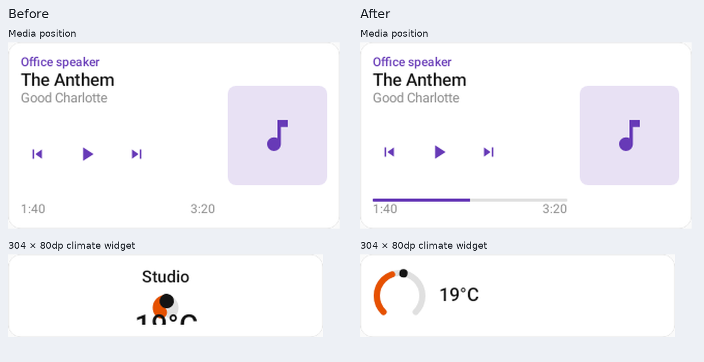

# Widget layout regression evidence

Follow-up to the ten community design families. These fixes apply to the existing
shared card components and are independent of the new family registry.

- A 304×80dp thermostat previously selected the full vertical dial because it was
  wider than 260dp. Its value and steppers fell below the visible cell. The shared
  thermostat/humidifier/light ladder now requires both 260dp width and 290dp height
  for the full layout, using the existing two-dimensional gate. Short cells use
  the horizontal reading; tall cells retain their actions. The Wear height ladder
  and wrap-content cards retain their existing selection paths.
- A media card's progress track had 4dp top padding inside its fixed 3dp height.
  Applying the padding outside that height gives the 3dp track its own space.
  The position binding and all transport actions are retained.

The two new `LauncherDesignsTest` regressions fail on unchanged `main` at
`6b00df1d`: the media accent has only a 13px continuous run (no progress track),
and the short thermostat still captures off-screen climate service actions.
The tests bake their visual fixtures at the mdpi player density. The existing
420dpi action/platform tests remain separate. The climate regression also checks
thermostat, humidifier and light widgets in Classic, Console and IKEA styles,
with short and tall cells. The media test requires a visible half-full track and
retained transport actions.

Reproduce:

```sh
./gradlew :rc-converter:testDebugUnitTest --tests '*LauncherDesignsTest'
```

Images come from the real Compose player with realistic entity data, at
304×80px (climate) and 320×180px (media). No image exceeds 1800px. Early screenshots
with mismatched document/player density were replaced with these matched captures.
No physical-device or browser run was performed locally.



Verified: 193 tests passed (`rc-components`: 80; selected converter suites: 113,
including all 20 launcher tests), plus Android app/shared JVM compilation and
repository-wide `ktfmtCheck`. The two failing baselines pass with the fixes;
the half-full progress track now has a 94px continuous accent run.
