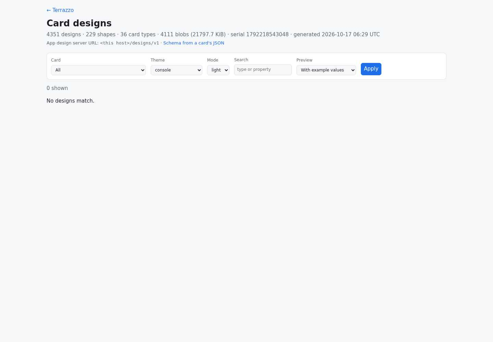
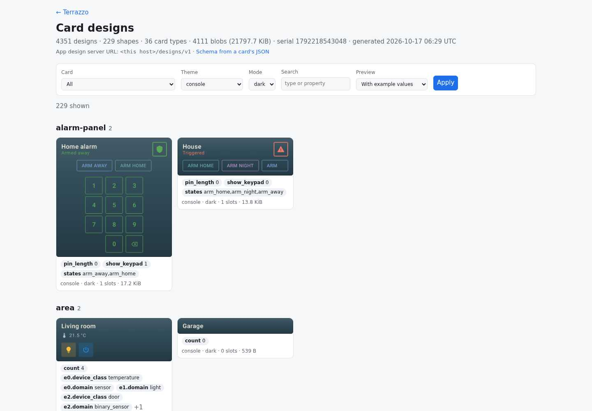
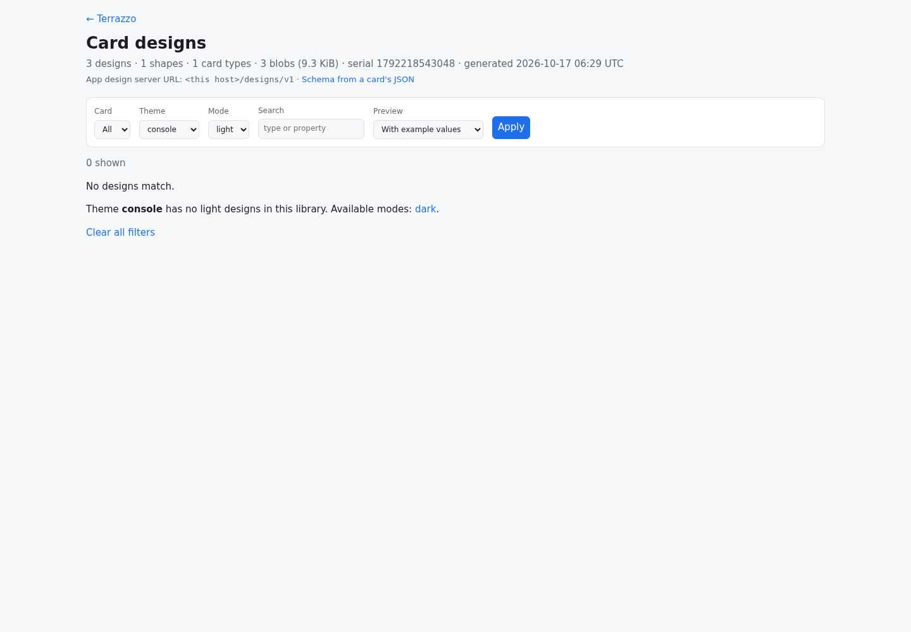
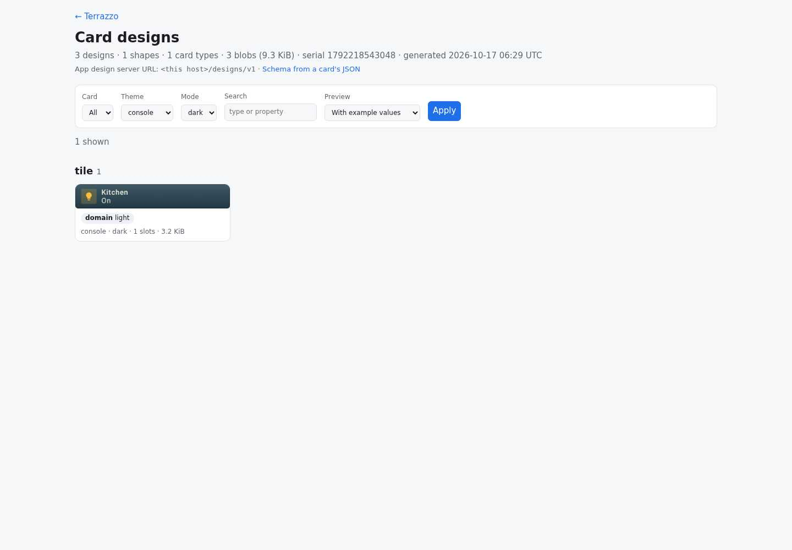

# Console light investigation

Observed on 2026-10-17, using Chromium at 1440 × 1000.

## Deployed observations

Exact URL: <https://ha.coo.ee/designs?type=all&style=console&mode=light&q=&preview=example>.

- HTTP 200, title `Card designs`, `0 shown`, `No designs match.` Browser console empty.
- This is server-rendered HTML with no scripts or preview images in the response. No preview
  requests are made for the empty result. Changing `preview=example` to `preview=template`
  produces the same empty result and HTTP 200.
- `/designs/v1/manifest.json`: HTTP 200, serial `1792218543048`, generated
  `2026-10-17 06:29 UTC`, 4351 designs across 19 theme/mode combinations, 229 per combination.
  `style:console:dark` has 229 entries; `style:console:light` has none.
- `/api/designs?style=console&mode=light`: HTTP 200, count 0.
  `/api/designs?style=console&mode=dark`: HTTP 200, count 229.
- Changing only `mode=light` to `mode=dark` on the exact URL shows 229 designs. The first three
  previews decoded successfully, with natural dimensions 640 × 662, 640 × 210, 640 × 240.
- Sample tile `0877bb99d3946206`: example PNG HTTP 200 (8091 bytes), template PNG HTTP 200
  (8185 bytes), RC blob HTTP 200 (3302 bytes). Both PNGs decode at 640 × 102.

## Root cause

`HaUberTheme.Console` explicitly declares `light = null` and documents itself as dark only.
`CardDesignTemplates.drawnDark` maps either host mode to dark for a dark-only style, and
`modesOf` deduplicates those modes. `GenerateCardDesignLibrary` captures only those supported
modes. The deployed manifest matches that contract; missing light artifacts are intentional.

`BrowserFilter.apply` intersects style and mode literally. The browser's globally populated
mode menu permits console + light, and previously its generic empty state did not explain
that combination or offer recovery. Also, an omitted mode defaulted to the entire library's
first mode (light), even when the selected style only supports dark.

The failing page is served by `design-server`, backed by its generated library and catalog,
not by the UI Builder catalog renderer. The successful HTML/API responses and decoded dark
previews establish filtering and empty-state behavior for this URL; they do not indicate a
runtime, preview-rendering, missing-publication, or deployment failure.

## Change

Choose the selected style's first available mode only when the browser's mode is omitted.
Keep explicit filters strict, including in the JSON API. For unsupported explicit combinations,
explain the available modes from the loaded library and link to them while retaining card,
search and preview filters. Offer a clear-all link for any empty result. No palette, converter,
artifact generator, deployment, or Lovelace editor changes.

Local verification and screenshots are recorded below after running the updated server.

## Local verification

The updated installed server ran at `http://127.0.0.1:8080` with a three-design subset downloaded
from the deployed library: the same light-domain tile in Material3 light, Material3 dark, and
console dark, including all three real blobs and both PNG previews per design. This keeps the
same unsupported combination and genuine preview bytes without regenerating the full matrix.
The screenshots therefore show 3 total designs and 1 recovered console result, rather than the
production library's 4351 total and 229 console results.

- `./gradlew :design-server:test --tests ee.schimke.ha.designserver.DesignServerTest`: 15 tests
  passed, including the exact query string, supported-mode default, explicit strict filtering,
  preserved card/search/template-preview filters, escaped link parameters, and ordinary empty
  results that must not be diagnosed as a mode mismatch.
- `./gradlew :design-server:test :design-server:installDist :design-server:ktfmtCheck`: passed;
  all 61 server tests passed, zero failures/errors/skips.
- `STUDIO_SERVER_URL=http://127.0.0.1:8080 STUDIO_SMOKE_REQUIRED=1
  PLAYWRIGHT_MODULE=/tmp/design-browser-node/node_modules/playwright/index.mjs
  node --test design-server/test/design-browser.test.mjs`: 1 test passed, zero skips.
  It navigates with the exact query, verifies the explanation and unchanged light filter,
  clicks dark, checks a nonzero result, decodes a preview and checks its PNG response, and
  verifies there are no JavaScript page exceptions. The same regression failed against the
  unchanged deployment because `.mode-hint` was absent.
- Manually viewed the local exact-query page and followed its recovery link in Chromium.
  Both document responses and the recovered PNG returned 200; preview decoded at 640 × 102.
  The direct local server also receives a browser-generated `/favicon.ico` request (404);
  the deployed host serves that request with 200. This does not affect either page or preview.
- All screenshots are 1440 × 1000. The UI Builder editor and its catalog were not needed for
  this server-rendered filtering path. No deployment, merge, or production mutation was performed.

Repository-wide `./gradlew ktfmtCheck` also passed.
