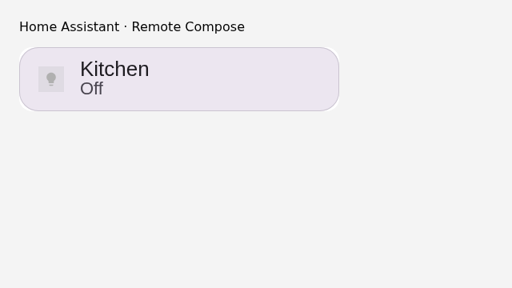
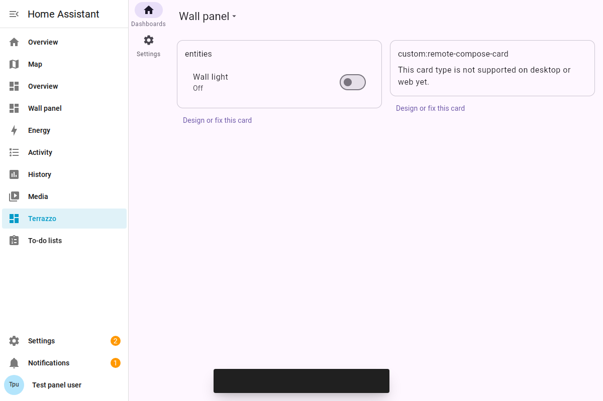
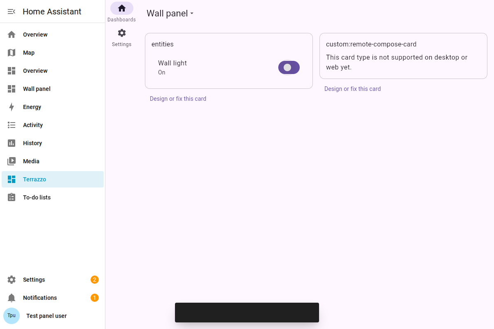
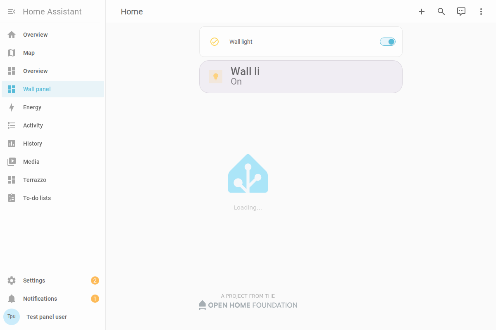
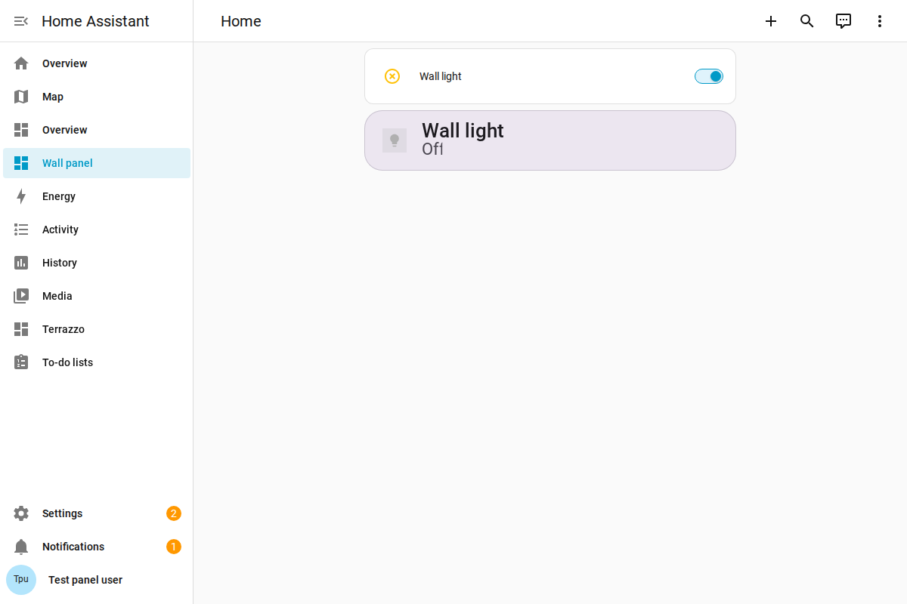
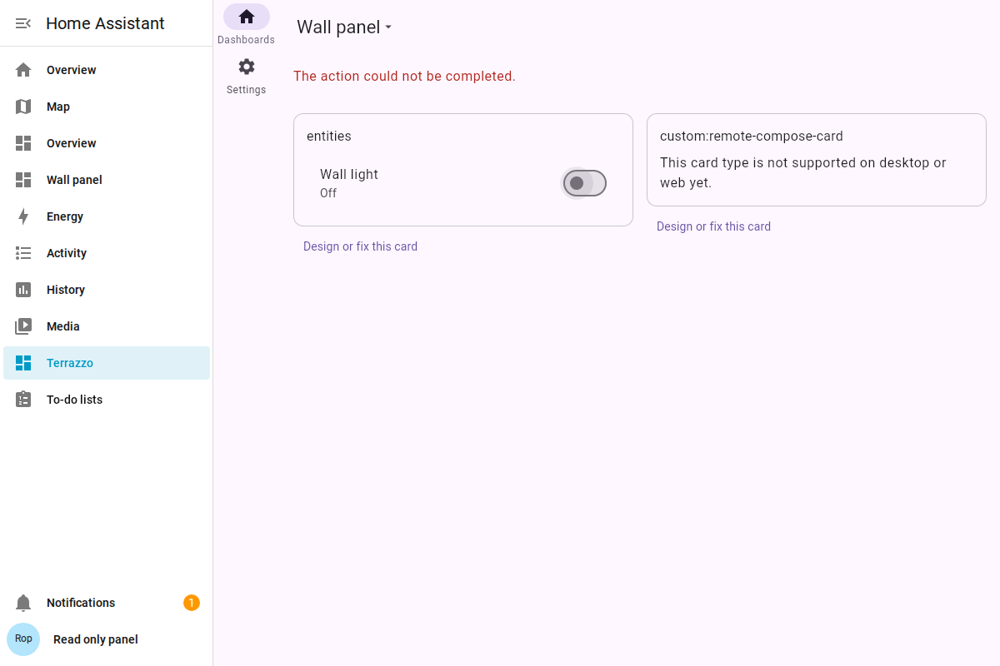

# Home Assistant custom-card rendering evidence

`card-before.png` and `card-after.png` were captured locally by
`home-assistant/test/frontend.test.mjs` in Chromium at 640 × 360, device scale 1.
They show the actual TypeScript Remote Compose player rendering the repository's
`tile-light.rc` test document, before and after HA's supplied entity changes from
off to on. The test verifies different rendered pixels, named binding updates,
a real canvas click reaching the signed-in user's `hass.callService`, removed
entity clearing, and permission-error display. The HA object is a fixture, not a
live home. The player used locally was fetched from the existing
`https://ha.coo.ee/embed/v1/rc-player.js` endpoint; CI uses the Gradle-pinned bundle.

CI additionally retains screenshots of the packaged production WASM panel at
`/terrazzo` and the custom card running inside a fresh real Home Assistant instance
in the `home-assistant-plugin` artifact. See the PR checks for that evidence.

## Installed Home Assistant verification

[Run 39033517174](https://github.com/yschimke/homeassistant-remotecompose/actions/runs/39033517174)
passed at implementation commit `1c0acc07a`. It built the production WASM and TS
players, ran shared JVM and formatting checks, packaged the integration, passed
both frontend tests, and passed the installed-HA browser test. All captures below
are 1200 × 800 from that run, using a fresh synthetic HA home and users.

The panel now fills the viewport. The authenticated user changes the light from
off to on through the WASM dashboard:

The native Lovelace card receives the on-state live binding, renders the actual RC
document, and dispatches a canvas tap that turns the light off:

The read-only HA user receives an action error and the light remains off:

Limitations visible in these captures: the WASM host shows its existing unsupported
card placeholder for the custom Lovelace card; that card runs in native Lovelace.
The TS tile can clip a longer live entity label to the template text width. The
on-state capture also retains HA's transient loading overlay because the test
waits for the card's live binding rather than all frontend transitions. Screenshots
alone do not establish live updates: the test additionally checks live bindings,
the authenticated HA state endpoint after each action, and read-only denial.
