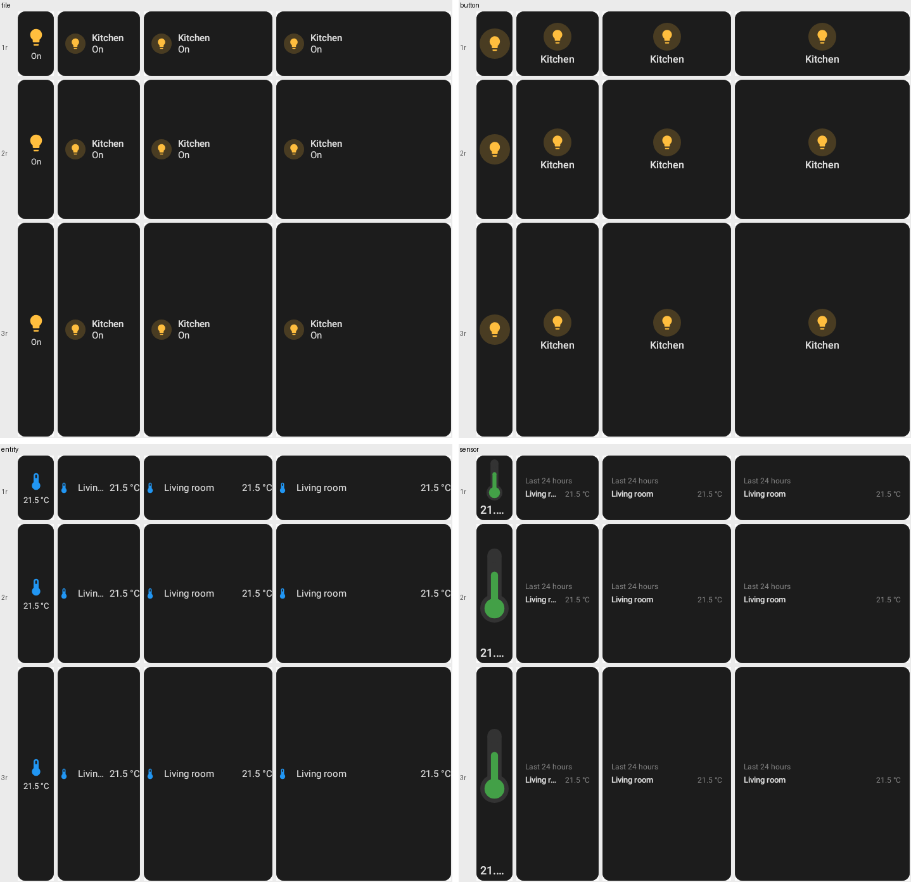
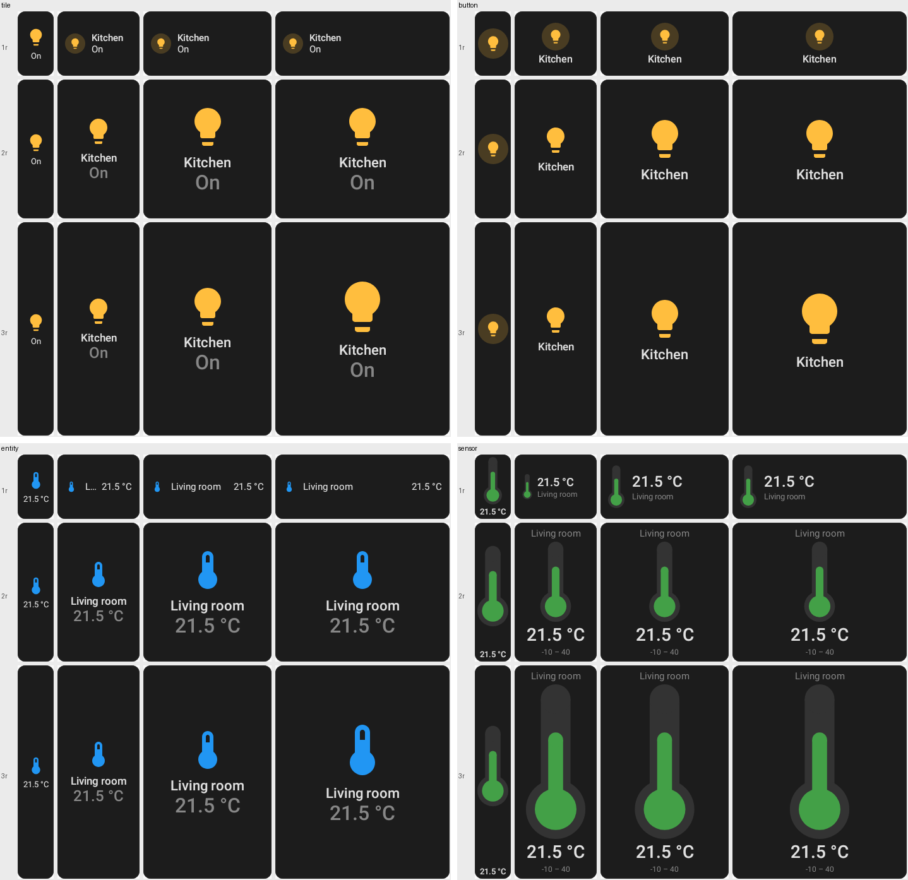
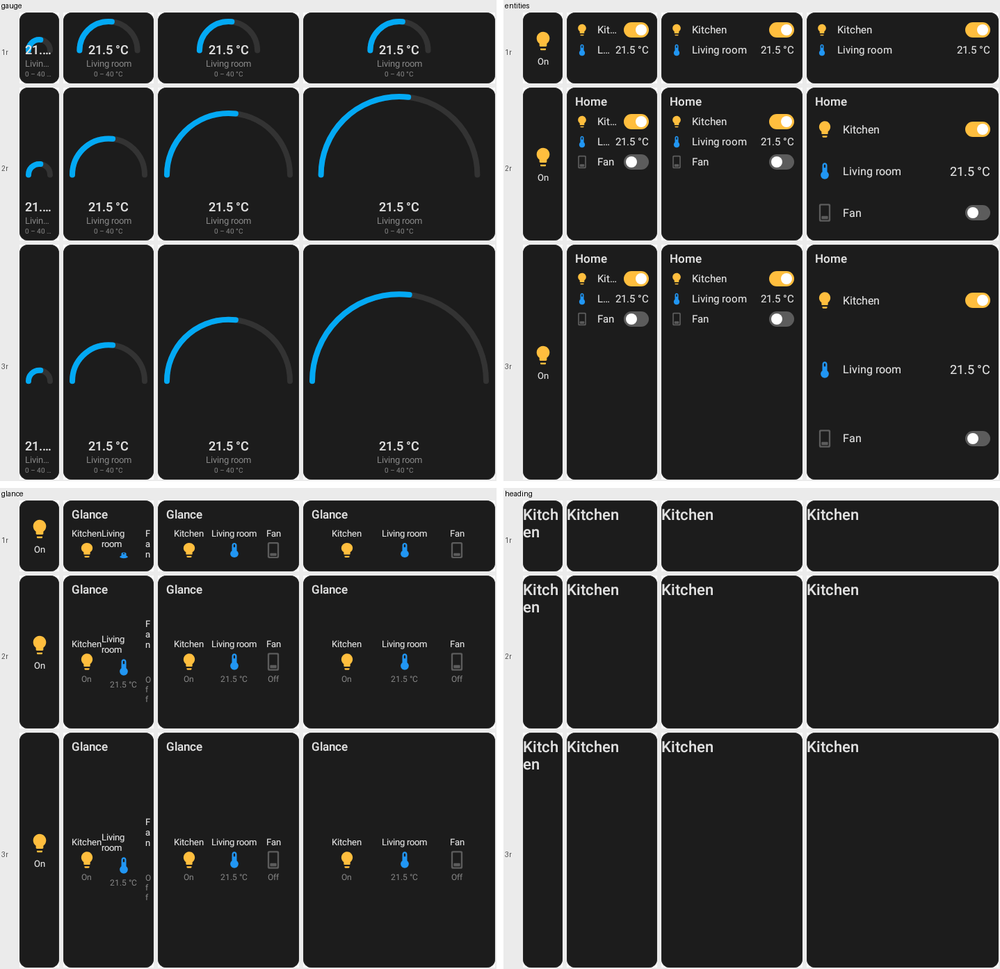
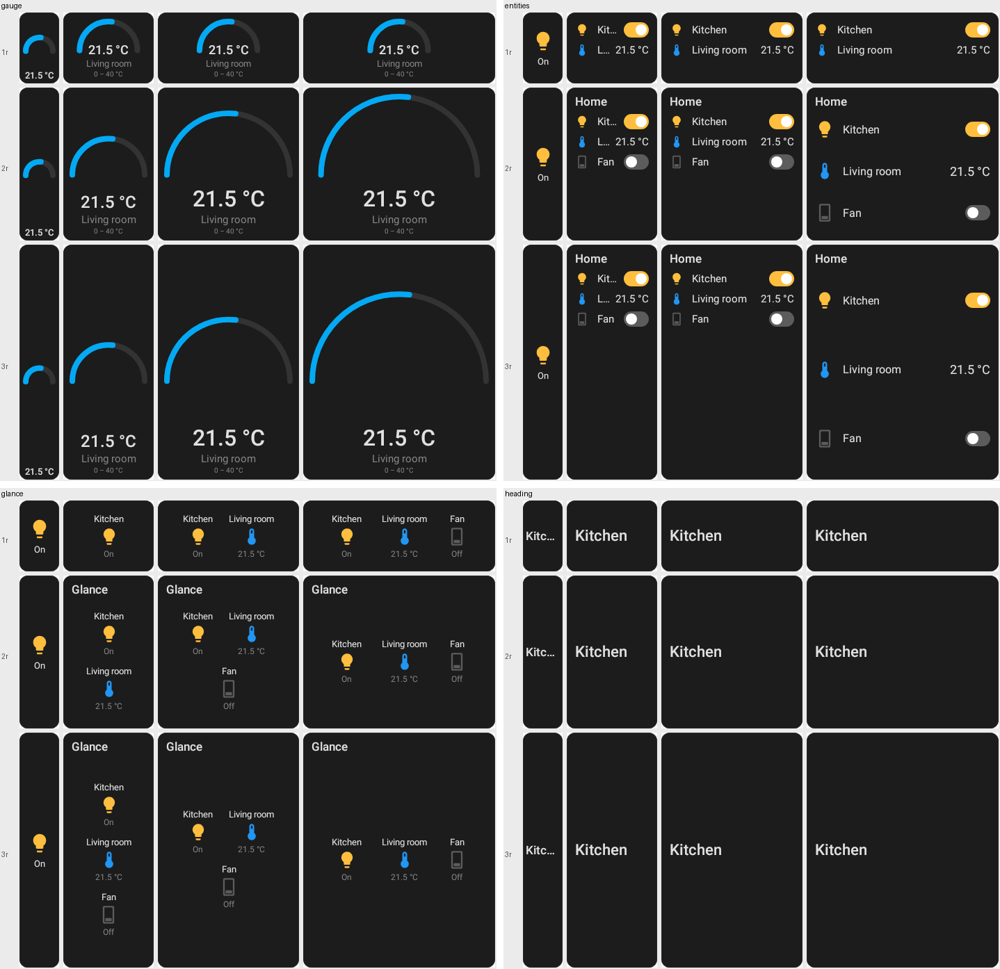
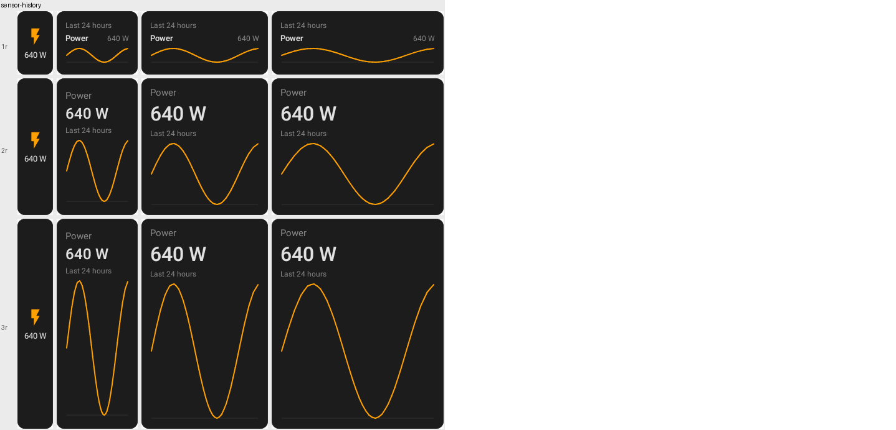

# Launcher widget resize sweep

Every card `LauncherGridSweepTest` covers, drawn the way the launcher draws it (captured at the
widget's size, baked with its values) on Android's grid from `1×1` to `4×3`: columns left to right,
rows top to bottom, `(73n − 16) × (118m − 16)` dp.

```
./gradlew :rc-converter:testDebugUnitTest --tests '*LauncherGridSweepTest*'
# renders land in rc-converter/build/launcher-sweep/<card>-<n>x<m>.png
```

| | Before | After |
| --- | --- | --- |
| tile, button, entity, sensor |  |  |
| gauge, entities, glance, heading |  |  |
| sensor with history | — |  |

The rules these follow are in
[adaptive-card-layouts.md → Launcher widgets](../../architecture/adaptive-card-layouts.md#launcher-widgets-decide-at-capture-in-both-directions).
