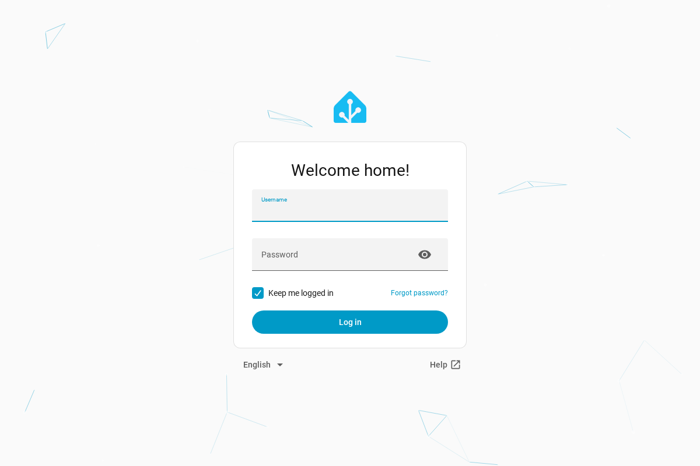
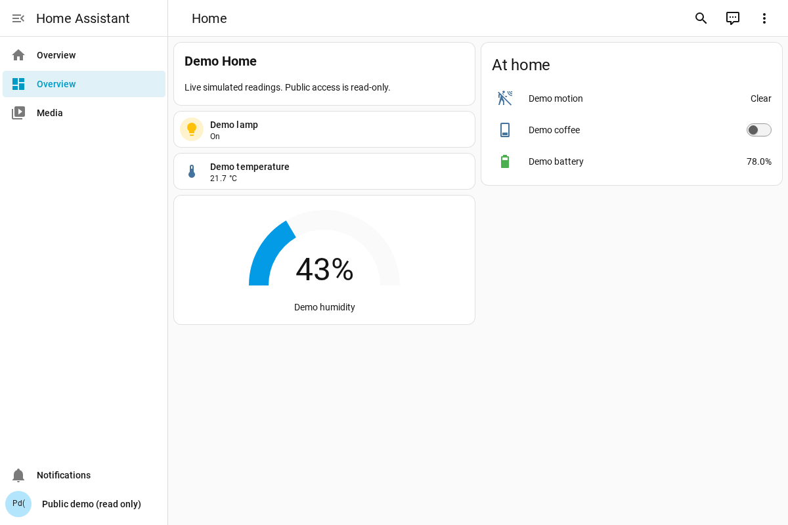
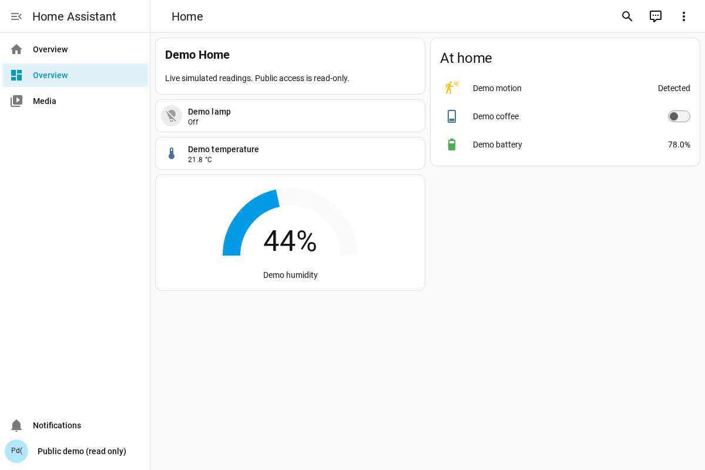

# Native read-only HA dashboard verification

Local verification used real Home Assistant 2026.10.2 and its matching frontend
20260930.4, installed in an isolated Python 3.14 environment. The configuration
and six entities are the committed synthetic demo. Chromium rendered at 1200 ×
800, device scale 1. No real home or public deployment was accessed.

`deploy/demo-ha/native_browser.test.mjs` passed: login through HA's actual form,
non-admin guest identity, native Lovelace cards, six denied WS commands, three
denied REST mutations, unchanged battery/dashboard, a real minute-based sensor
update, and token refresh. The gateway unit tests separately prove denied inputs
never reach upstream and that operator tokens cannot authenticate through it.

Independent private-network probes bypassing the guard confirmed HA itself
rejects the guest's REST service call and WS service call. The WS rejection was
`success: false`, `home_assistant_error`, `Unauthorized`.

Before the native overlay there was no native public frontend. The captures show
the new guest login, then the native dashboard before and after a real template
sensor update. They are fixture evidence, not evidence that ha-demo.coo.ee is live.
The Docker/edge deployment lane is exercised by demo-ha.yml in CI.

