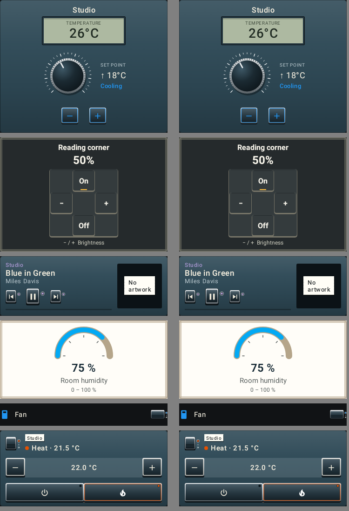
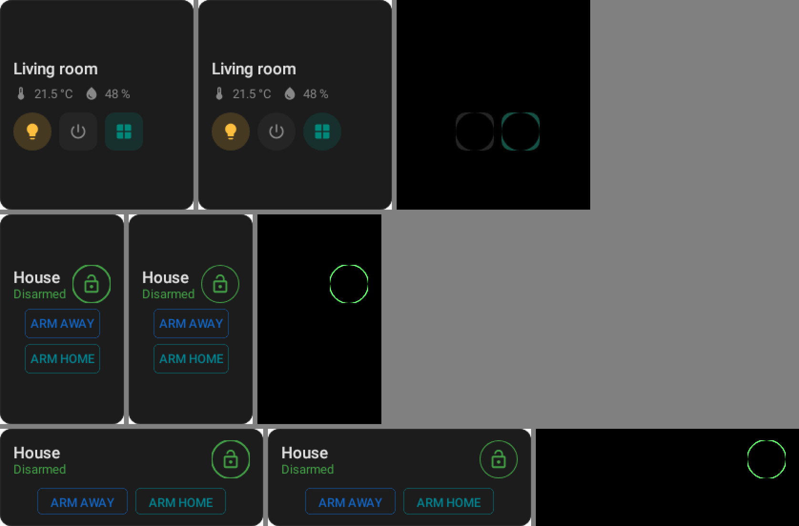

# Card authoring on rc-players' creation API: before and after

Cards moved from AndroidX's creation API (1.0.0-alpha23, and its fork at 2.29.0 off Android) to
rc-players' Compose Multiplatform one
([rc-creation-migration.md](../../architecture/rc-creation-migration.md)). The documents change;
what they draw should not. These are the repository's render tests on `main` and on the branch:

```
./gradlew :rc-converter:testAndroidHostTest \
  --tests '*LovelaceDashboardRenderTest*' --tests '*ConsoleDesignRenderTest*' \
  --tests '*CommunityFamilyLiveRenderTest*' --tests '*HomeAssistantThemeRenderTest*' \
  --tests '*IkeaDesignRenderTest*' --tests '*LauncherGridSweepTest*' \
  -PlovelaceRenderEvidence=<dir>
# the launcher sweep lands in rc-converter/build/launcher-sweep/<card>-<n>x<m>.png
```

| Set | Images | Identical | Different |
| --- | --- | --- | --- |
| In-app cards, themes and families (`-PlovelaceRenderEvidence`) | 160 | 160 | 0 |
| Launcher widgets, every card on every cell (`LauncherGridSweepTest`) | 444 | 416 | 28 |

In-app cards, before (left) and after (right), pixel for pixel the same:



## What differs on the launcher

Before, after, and the difference (×4), at twice the size:



| Cards | What changed | Why |
| --- | --- | --- |
| `area` (10 cells) | The second and third action chips are circles, as the first always was. | A chip is `clip(RemoteCircleShape)`. In alpha23 a circle's radius was read from the component written before it, not from the chip itself, so a chip after the first took a sibling's size. androidx-main scopes a size to its own component (`ab1b76a2f`), which rc-players' creation carries. |
| `alarm-panel` (6 cells) | The state badge's ring is a whole circle; its sides were cut flat. | The same: the badge's circle clip and border now read the badge's own size. |
| `clock` (12 cells) | The time. | The two runs were seven minutes apart. |

The players are not the cause: `main`'s authoring played by rc-players 3.1.0's players draws what it
draws with 3.0.0's, on all 432 cells but the clock's.
