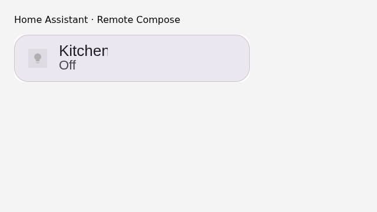
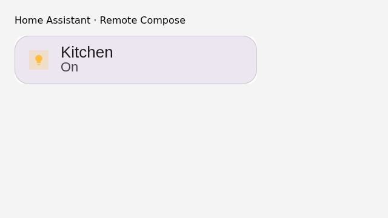

# Direct template URL browser evidence

Captured by `home-assistant/test/frontend.test.mjs` in Chromium at 640 × 360,
device scale 1. The native Lovelace adapter loads the real `tile-light.rc`
document through `/local/cards/kitchen.rc`, without a design resolver. HA state
and network responses are synthetic fixtures; this is not a deployment into a
user's Home Assistant instance.

The same suite passed for an absolute cross-origin HTTPS template URL and the
existing SHA-256 library selection. It checks changed rendered pixels and named
bindings after Off → On, a real canvas tap reaching `hass.callService`, removal
of an entity, action permission errors, and rejection of unsupported template
bindings. All six adapter/panel/configuration tests passed locally.

The player used for this local run was downloaded from
`https://ha.coo.ee/embed/v1/rc-player.js`, SHA-256 `76981e1e64bb1170b8efd50663b8e1de50d336922ad1930bd3ae284b5d4129b2`.
CI builds the Gradle-pinned player and additionally runs the installed-HA suite.

