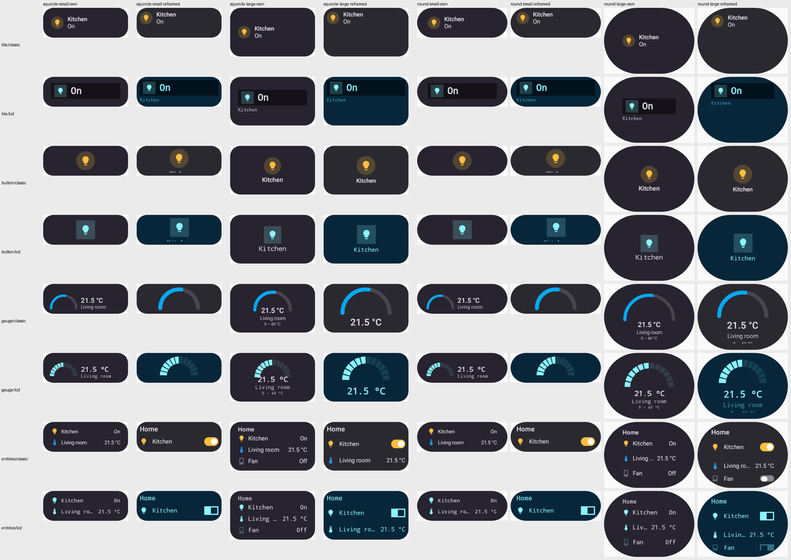
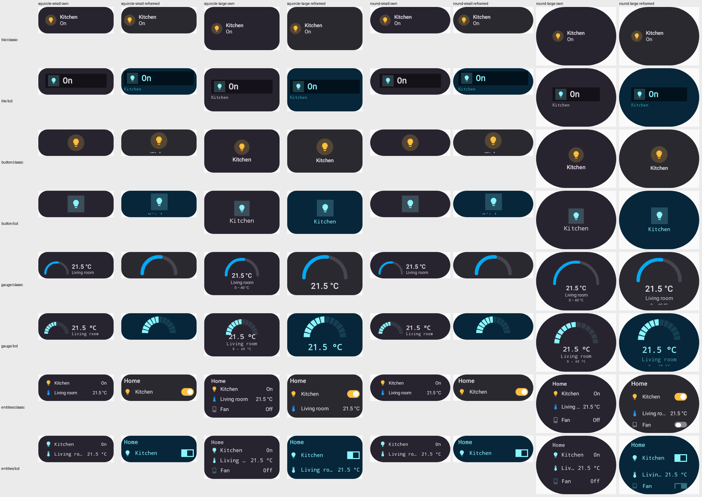

# Phone card designs reframed into the Wear container

`CardDesignWearTemplateTest` renders tile, button, gauge and entities in the Classic and lcd card
styles on Pixel's squircle and Samsung's round host at Small and Large. Each host has two columns:
the watch's own capture (`own`) and the phone card design reframed into the container
(`reframed`).

```
./gradlew :wear:testDebugUnitTest --tests '*CardDesignWearTemplateTest*'
# renders land in wear/build/wear-reframe/
```

| Before: top-aligned in a Large container | After: centred |
| --- | --- |
|  |  |
