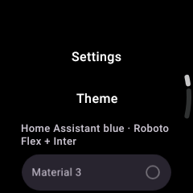
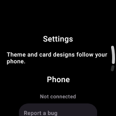
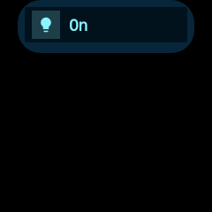
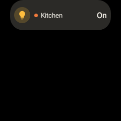
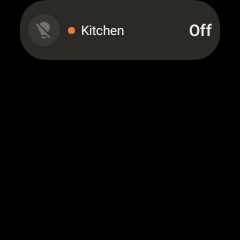
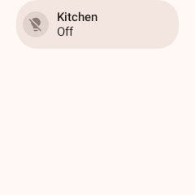
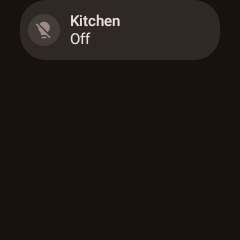

# Wear follows mobile appearance

Robolectric native-graphics captures, API 35, 240 × 240 px. These are composable renders rather
than photographs or captures from a paired physical watch.

| Settings before | Settings after |
| --- | --- |
|  |  |

The before image runs the original `WearSettingsScreen` from the parent commit. Its source was
copied temporarily into the test source set under a different function name, rendered with the
same Wear Material theme/background, then removed after capture. The after image comes from
`WearDashboardRenderingTest.settingsOnlyExplainsMobileAppearanceWithoutWatchSelection`.

| Synced LCD design | Synced Braun design | Braun after live update and offline replay |
| --- | --- | --- |
|  |  |  |

`WearDashboardRenderingTest.syncedInstalledDesignChangesPixelsAndSurvivesOfflineRestart` writes
the phone's settings and template/index wire models into the offline store. It renders LCD,
delivers a Braun index before its template, delivers the template separately, changes the live
entity from on to off, and recreates the card using the persisted design. It asserts pixel
changes for design and value updates and identical pixels on offline replay. Its palette/global
style stay fixed, so the selected template must drive the artwork.

Other regression checks cover newer settings winning over delayed DataItems, startup reads,
reconnect-style updates, old/future field defaults, installed phone-only designs winning over
generic Wear templates, large payloads using assets, out-of-order index/blob persistence,
phone-driven widget styling and warming the synced template rather than a local fallback.

Run the affected suites and checks:

```sh
./gradlew :wear:testDebugUnitTest :app:testDebugUnitTest
./gradlew :wear:lintDebug :app:lintDebug :wear:ktfmtCheck :app:ktfmtCheck
```

`WearThemeModeRenderingTest` renders the same persisted System mode with the watch's own light
and dark configurations, verifies explicit Light/Dark override an opposite watch mode, then
recreates the card from disk and changes the watch mode offline without another phone payload.
Both template modes are cached, selected by their synced mode tag, and rendered with matching
app chrome. `WearAppearanceSyncTest` also verifies the mode survives delayed events and restart.

| System: watch light | System: watch dark, without another phone payload |
| --- | --- |
|  |  |

The rendering tests can save PNGs when its test JVM receives the `wearRenderEvidence` system
property. These captures used a temporary Gradle init script that set that property on `Test`
tasks to `/tmp/wear-render-evidence`.

Physical transport remains a manual follow-up: pair updated phone/watch builds, change theme,
global style and a card's installed skin on the phone. Set System with opposite phone/watch
appearances; verify Wear uses its own mode, then test explicit Light and Dark. Disconnect,
restart both apps, change
mobile appearance while disconnected, then reconnect. Confirm the app and placed widgets retain
the last synced look offline and converge to the current phone choice after reconnect. This VM
has no paired watch and no `/dev/kvm`; the automated checks exercise payloads, persistence and
actual rendering, without claiming a physical Bluetooth/Wi-Fi reconnect test.
